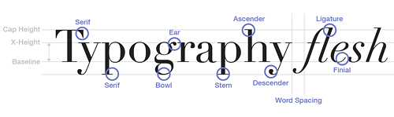

We started off by having a run down of typographic concepts we covered last year such as kerning, tracking, leading and typeface terminology so we have a better understanding of the elements that make up type such as serif and sans serif, ascenders, stems and bowls.

