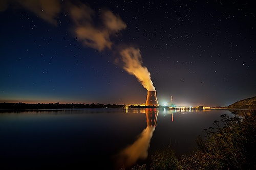
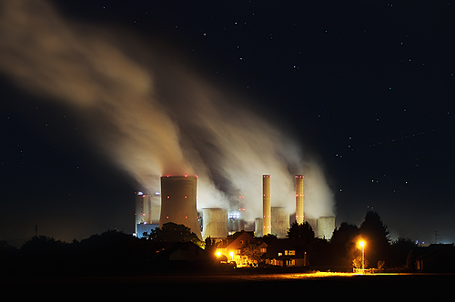
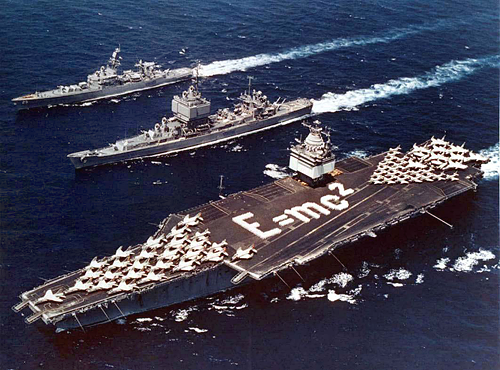

So what exactly is nuclear power anyway? Basically it’s a term used to describe the use of controlled nuclear fission to generate heat and energy. Essentially it’s like a giant kettle heating water and turning it into steam which gets fed into a turbine, generating power.

It’s basically the same as any power plant, the only difference is how the water is heated. They use tubes filled with pellets of uranium oxide because uranium is an atom that we can split as it’s a ‘heavy’ atom. Uranium exists in abundant amounts in the crust of the earth, and by abundant I mean a lot more than any fossil fuels.

Nuclear power plants produce about 6% of the energy in the world and about 14% of the electricity and compared to other means of producing energy it’s much cleaner because it doesn’t produce any pollutants; such as poisonous gases like carbon dioxide, sulphur dioxide or nitrogen dioxide. So there isn’t anything dirty being thrown out into the atmosphere meaning it’s not contributing to global warming.

Another great aspect of people using the power generated by nuclear power plants is that if an average family of four uses nuclear power for everything over the course of an entire lifetime the waste they produce is about as big as a tennis ball. Compare this to the carbon foot print created over a year with conventional fossil fuels, where people and companies are doing all they can to offset this.

The process of actually disposing of the nuclear waste is actually very easy. Nuclear waste gets stored in special repositories under highly controlled conditions where it decays over time. The way it’s disposed of now is far more advanced to how it was done in the past. There is a lot of care taken to ensure it can’t contaminate the environment and there would need to be an enormous amount of radiation to contaminate the environment.

As a result of this there’s no negative impact on the ecosystem, because in nature, some of the substances decay naturally by themselves. This turns out to be one of the main benefits of nuclear power compared to the chemical waste of other means of energy production like arsenic or mercury.

A lot of attention goes into containing any waste from nuclear power plants, even the lowest level waste such as office equipment and tools are carefully scrutinised and sealed in special containers. The more hazardous materials, dismantling of the reactors and the extraction of the fuel is even handled by automated robots remotely reducing risk and cost of decommissioning and disposal of waste.

One downside to the nuclear waste is the extremely long half life, ranging to millions of years in some cases however a technique has even been discovered allowing for the speeding up radioactive decay that can render nuclear waste harmless on timescales of just a few tens of years. This means nuclear waste can be dealt with entirely within the lifetimes of the people that produce it as opposed to containing it underground for future generations to deal with it.

Then there is the issue of cost, the rate of cost per energy unit is far less than that of a regular fossil fuel. This and the fact it is extremely abundant keeps costs down significantly across the production of the energy, which translates to the end user meaning they don’t need to pay nearly as much as they would if their power was coming from a different resource where there are astronomical costs in extracting the fuel alone.

They are a reliable source of power production as well because the average life cycle of a reactor is a staggering 40 years and that can be extended to 50 to 60 years in some cases. There are also times when the amount of energy needed by the power grid can drastically change. Sun, wind, tides and waves can’t be controlled to provide direct bursts of power at peak times but nuclear power is completely controllable.

Not only is it one of the most reliable sources of energy but contrary to popular belief it is very safe. Accidents rarely happen because power plants are equipped with means of stopping what’s going on inside the reactor as soon as a problem appears. This is also called emergency cooling to the nuclear core. The process is very simple and most of what goes on at a nuclear power plant is merely there to monitor and control the reaction.

There are also many ways to combat the threat from natural disasters and other uncontrollable events that may compromise a nuclear power plant. Usually ones which fail are very old but the technology used today has improved a lot since those made 30 to 40 years ago. So there are plenty of fail safe’s to prevent disasters from occurring.

Very few people are likely to die as a result of both the initial accident and long term radiation health effects compared to other disasters related to different forms of power generation. For instance the implications of a fires and explosions on oil rigs, the collapse of coal mines, the huge scale environmental damage from oil spills on the ecosystem. Nuclear power plant accidents can be contained, the human population evacuated and the environment surrounding them generally lives on and thrives.

Let’s put things into perspective:

> Smoking Related Deaths (2009)  
> 107,000
> 
> Dam Burst (Hydro Electric Power)  
> 26,000
> 
> Hiroshima and Nagasaki (Radiation)  
> 20,000
> 
> Road Accidents (2009)  
> 2,222
> 
> Chernobyl (Radiation)  
> 122
> 
> Falling out of Bed  
> 106
> 
> Fukushima (Radiation)  
> 0 (Predicted)

Another advantage is that nuclear power plants don’t take up a lot of room meaning people can make a lot of these machines all over the earth to make electricity. For instance remote locations that need a lot of power that don’t have access to any naturally occurring renewable energy and even using them in transportation like ships and submarines.

Nuclear submarines utilise nuclear power so they don’t need to be refuelled for up to 30 years, they also don’t need to act like conventional submarines that need ‘air’ to actually change their depth and they can run much faster than conventional ones and they don’t produce vast amounts of waste and emissions compared to diesel or other fuels. There is waste but nuclear waste over 30 to 60 years which is also much less than waste and emissions caused by regular fuel such as the large conventional engines powering ships.

Also, in the book Why vs. Why: Nuclear Power, the authors debate about nuclear power. They argue that there are seven reasons why people should be open to nuclear power:

*   Renewable energy and energy efficiency won’t solve the energy and climate crisis
*   Nuclear fuel is virtually unlimited and packs a huge energy punch
*   New technology solves the “nuclear waste” problem
*   Nuclear power is the safest energy option
*   Advanced nuclear power will strengthen global security
*   Nuclear power’s true costs are lower than either fossil fuels or renewables
*   Nuclear power can lead the “clean energy” revolution

In regard to the general fear of radiation there are many benefits of radiation people often overlook. Radiation is used in various applications such as cancer treatment and radiocarbon dating and radiation is also found in everything including your body, the things you use and eat throughout the day.

So the fear of nuclear power plants and their contamination of radioactive materials is generally exaggerated, especially in the media. But when you look into the fine details the risk becomes ever more smaller.

**References**

[Why vs Why: Nuclear Power](http://www.amazon.com/WHY-vs-Nuclear-Power/dp/0980741858) - Barry Brook and Ian Lowe

[The Pros and Cons of Nuclear Power](http://science.howstuffworks.com/nuclear-power4.htm) (HowStuffWorks)

[The Positive Effects of Nuclear Power Plants](http://www.ehow.com/list_5879594_positive-effects-nuclear-power-plants.html) (eHow)

[How Nuclear Power Could be the Best Option for Wildlife](http://www.newscientist.com/article/mg12416935.200-forum-nuclear-power-yes-please--it-could-be-the-best-option-for-wildlife.html) (New Scientist)

[Nuclear Power Reappears on the Agenda](http://www.newscientist.com/article/mg12917541.400-nuclear-power-reappears-on-the-agenda.html) (New Scientist)

[A Cool Solution to Waste Disposal](http://physicsworld.com/cws/article/news/25446) (PhysicsWorld)

[Nuclear Power: Yes or No?](http://physicsworld.com/cws/article/print/43867) (PhysicsWorld)

[Do we need Nuclear Power?](http://physicsworld.com/cws/article/print/128) (PhysicsWorld)

[A Future for Nuclear Power](http://physicsworld.com/cws/article/print/24492) (PhysicsWorld)

[UK Opts for Nuclear Power](http://physicsworld.com/cws/article/news/32398) (PhysicsWorld)

[Beginner’s Guide: How Nuclear Power Works](http://www.guardian.co.uk/science/2008/apr/30/particlephysics.energy1) (The Guardian)

[14 Ways of Getting Rid of Nuclear Waste](http://www.guardian.co.uk/uk/2004/apr/14/nuclear.greenpolitics) (The Guardian)

[UK’s Nuclear Future](http://www.guardian.co.uk/business/2009/nov/08/nuclear-sites-edf-miliband-energy?intcmp=239) (The Guardian)

[A Reason to Bet on Nuclear Power](http://www.nytimes.com/2010/02/18/opinion/18thur2.html?scp=1&sq=a%20reasonable%20bet%20on%20nuclear%20power&st=cse) (The New York Times)

[Horizon - Fukushima: Is Nuclear Power Safe?](http://www.bbc.co.uk/programmes/b014s49z) (BBC)

[Bang Goes the Theory](http://www.bbc.co.uk/programmes/b015t2rr) (BBC)
