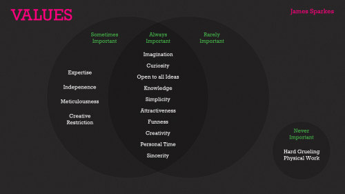

We were tasked with coming up with with a list of words that can be associated with some of the values we personally have. This would help us later on to get into groups with people with complementary values so that we can work together well delegating our skills into areas which would result in an efficient and product working environment.

I took some time to think about some words that I could use and a few I came up with include:

*   Personal Time / Space
*   Overall Curiosity
*   Innovation
*   Awareness
*   Understanding (of other’s views)
*   Honesty
*   Sincere
*   Straightforward
*   Simplicity
*   Attractiveness (things should be attractive)
*   Impulsive
*   Engaging
*   Fascinating
*   Compelling

However after careful deliberation these are the words I have chosen to represent some of my values in no particular order.

Download PDF Version
