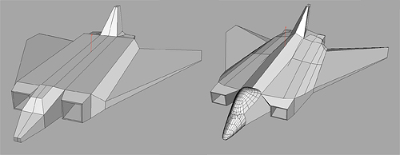
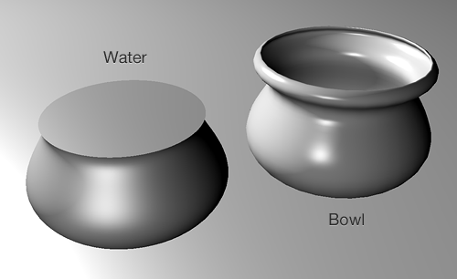
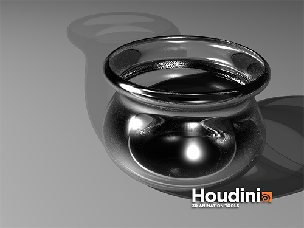

After learning the basics of extruding in Houdini I was able to experiment with making simple objects which were a step above the cubes and cylinders I had been using for learning lighting and camera basics. I looked at a few tutorials, preferably the shorter more simpler ones so I have at least a little understanding later on for the longer more complex ones where they presume a lot of prior knowledge.

Starting out from a box, dividing it into three segments and extruding parts of it until it resembled the vague outline of a plane I began to go into more depth and add details by transforming and moving certain points and edges. Another thing I learnt was mirroring your model, so what you do on one side is mirrored on the other side creating a symmetrical shape. I then added some sub divide to a few parts to round them down thus ending up with a crude jet fighter model which I will continue to develop while I learn new techniques.

Another interesting technique I learn was revolve, where I drew a NURBS curve, then applied a revolve to it creating a bowl shape. There is suposed to be water inside the bowl, however I have not yet taken the time to get the water to behave the right way in the light yet, I will go further into lighting later. The water was created by adding a carve to the original curve I had created and revolving that, then adding and end cap so it fitted the inside of the bowl perfecting resulting in to objects, the bowl and the water.

And here is the rendered image, however the water does not appear to be behaving properly in the light and appearing dark. Perhaps there are parameters I need to adjust somewhere for that, I will look at some tutorials which deal directly with water and lighting at some point.

