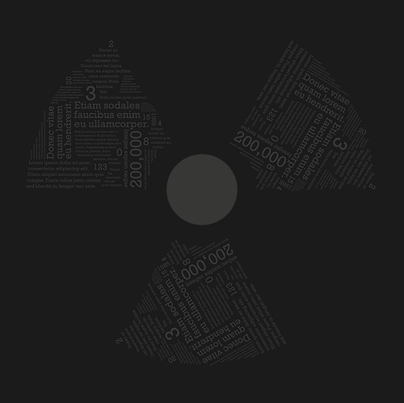

I have looked at a few ways of presenting the type on the argument square and have come up with a concept to express what I have in mind. It is only a rough idea but hopefully it should convey what I mean. I still haven’t thought of any ways of discerning from the two opposing arguments yet however.

The origianl idea was to use the CND symbol however in light of the critism in class, it does seem that using that will be confusing as the argument is mostly about power generated and not armament, also the use of it looked as though the positive side had lost the argument, and that the positive and negative space thing would have been too subtle to pick up on.

