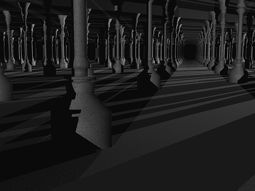

I was looking at how I can utilise the copy sop in order to create some kind of scene and one of the first things that came to my mind was the Mines of Moria in Lord of the Rings, a large cavernous expanse of identical pillars, I used to extruding to create a rough pillar shape, and applied a copy of that to all the nodes of a 2000 by 2000 grid with 50 rows and 50 columns. I’d like to put more effort into lighting now as my renders don’t look particularly interesting with some boring basic lights thrown in.

