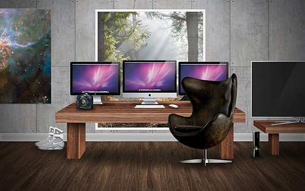

We were tasked to create some sort of way of expressing where we want to see ourselves in the future. In terms of what I will be doing I am not entirely sure as I am new to a lot of things I think I might want to go into, such as digital art and 3D. I haven’t been doing them for long enough to tell if I will pursue a career in them, at the moment I feel I can go in a few different directions by expanding my skills and doing traditional graphic design along with 3D and digital art or focusing on just on area. I decided to depict an environment I’d like to work in, regardless of what career path I take, I know that I would want to have the perfect office where I can feel productive.

Since I wasn’t sure what to do I thought I’d practice some photoshop techniques by creating a scene from scratch and populating it with a few objects I’d like in my work environment. Ideally I’d like to work in a space which made me feel comfortable and my own, where I can carry out whatever kind of work I may be doing. I would prefer to work in a studio environment because it’s i wide open area that you can do what you want with.
