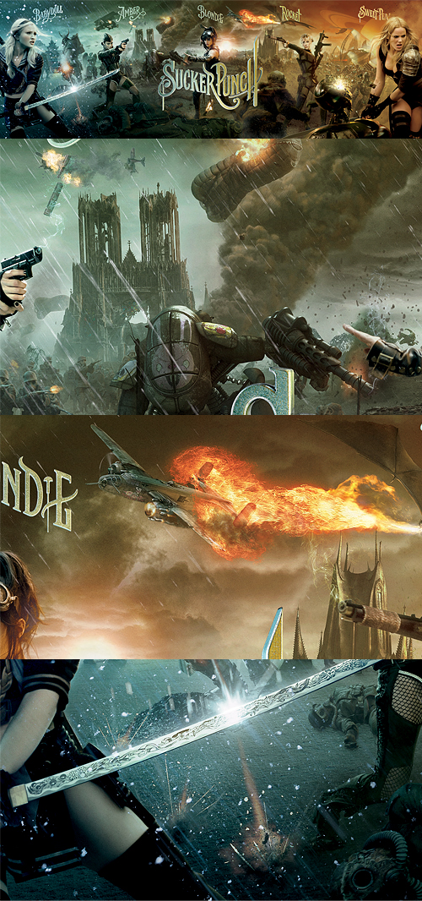
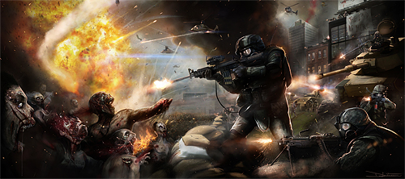
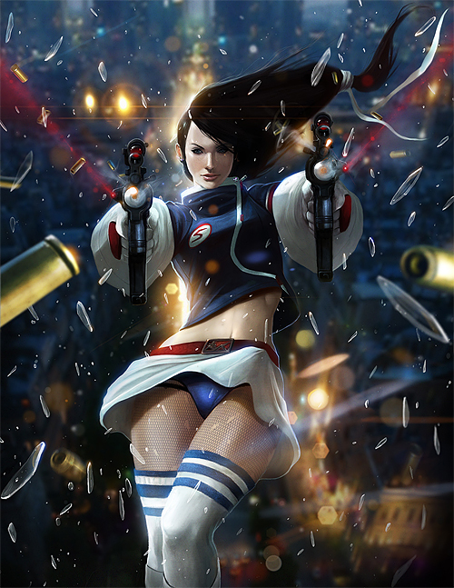
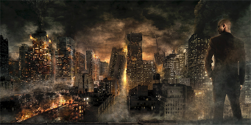
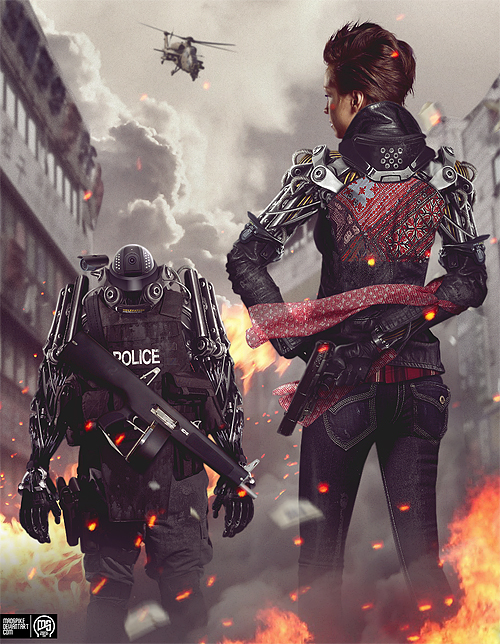
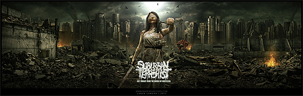
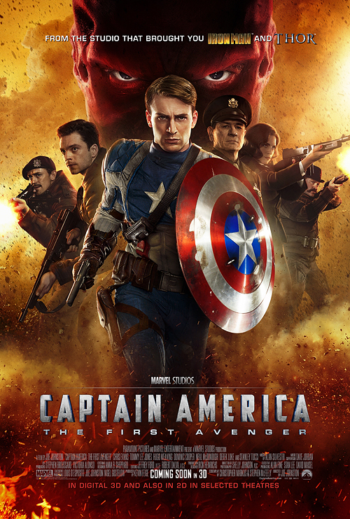
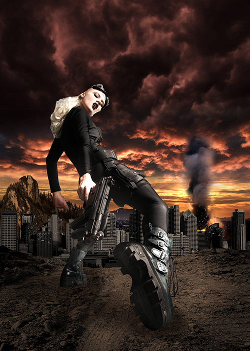

In preparation for the two final pieces I have begun thinking about what I will do about my compositions. I started looking at various pieces of works on deviantART, Béhance and other websites, and went through adding all the things I liked to collections and favourites, links to them can be found in the side bar.

In addition to looking at photo manipulations, I looked at photographs, digital paintings and matte paintings and how they are composed, and the atmosphere of them. I really want to bring across a fascinating atmosphere in my final pieces, so I am in the process of gathering influence and inspiration from various sources, and seeing what parts of them I want to extract and throw into my own compositions.

Other places I looked at were film posters, in particular the Sucker Punch poster. This really stood out to me as it contains many elements in one long poster, I would really like to show a lot of things happening in one of my pieces, so it tells a story almost, much like an elaborate sci-fi action film poster. However I also want it to be clean and concise, not bombarding too much noise and information at the people who would be looking at it.

As you can see from a few parts I have picked out, there are minute details that all give the scene depth, I’d like to bring across a sense of this depth into mine, so there is a greater scale of events going on past the initial scene you’d immediately see.

I was also drawn to a few pieces I had seen on deviantART, some of them are very dark and contain elements of destruction, for instance there’s a lot of rubble, fire, explosions, flying shrapnel and smoke. I will try and put these aspects in my piece as to give a dark and imposing feeling.

I also looked at some other film posters to see if there was anything I could take from how they are composed and their use of space. I probably won’t make a film poster, however I think there is a lot to be taken from how a comercial peice of work compares to something more artistic.

So after looking at all this I thought perhaps a good scene to portray would be a sort of futuristic sci-fi war, which would tie into the figure I chose from the figure pack. The only things I haven’t started thinking about yet are the objects I must place, but I will think about that at a later time in depth, for now I want to explore all the possibilities without limiting myself, I will keep them in mind, however.

I started to go through some stock so I can vaguely pieces together a quick scene to see what I am dealing with, and to get an idea of how I can compose this image. I gathered some elements from deviantART and stock.xchng which I placed in a document and very roughly cut them out using selection tools as I know this is a rough concept.

From this I can gauge how I might change and order the composition, and seeing something I had in mind in front of me has allowed me to think about where certain elements can go and how I can change the placement of things. I now have a clearly idea about where I want to go and what I don’t like so when it comes to properly composing my one of my final pieces the process should be quicker than starting from scratch.
