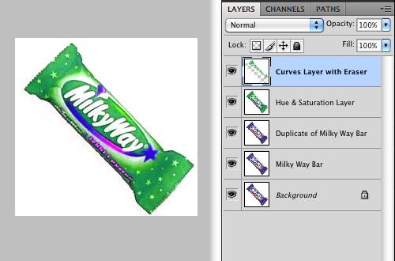
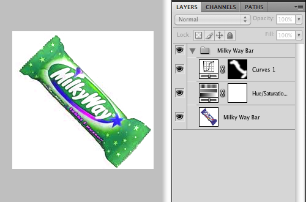

One of the first major classes we had on editing we were given the task to remove the background of the subject in the stock photo using layer masks. However we had to do it the wrong way, using the brush, going around it meticulously by hand which was very difficult and rarely accurate.

It put in perspective how useful and crucial the pen tool is having to do a task manually without it. It is something I wouldn’t ever want to do for large scale background removal after practicing with the pen tool since Dean taught it to us before the summer last year.

One of the advantages of using the brush tool is going around edges which need to be soft such as hair and for very tiny details that might not be suited to the pen tools hard edges.

I found using the brush tool useful instead of the pen tool useful when going around small hairs such as eyelashes, however it would be preferable to use a Wacom tablet for greater accuracy and speed.

Another thing I was enlightened on was the use of making groups for multiple layers. For instance this would be useful when things begin getting messy and you have so many layers it becomes almost impossible to find certain layers.

Making groups has streamlined my workflow significantly taking off a lot much time searching through unnamed layers turning the visibility on and off looking for what I want.

One of the most useful and crucial techniques was adjustment layers and using masks properly. I had always known about masks but I never really bothered to look into them and use them in my workflow, opting to duplicate layers to keep originals of things if I want to go back.

However after using masks properly has highlighted how much easier everything is with their reversible and versatile they are, meaning you can simply paint back anything you have hidden, this is not only applicable for the opacity of the layer but for anything and I now use masks for almost every task.

This ties in with adjustment layers which is another thing I was aware of but never felt the need to use them. But after seeing how much better they are than changing the entire layer permanently I now use them for everything.

Again, with adjustment layers my workflow has been significantly improved as I can change the adjustments at any time and also localise specific parts where those adjustments take effect utilising the masks. Before I would duplicate a layer, adjust it the old way and then use the eraser to localise it which was time consuming and restricting.

Here you can see how cumbersome the layers become when using the way I used to do it. Very quickly doing something complex would become overwhelming with multiple layers which probably won’t be named.

With the combination of layer masks and adjustment layers my work can now be completely non-destructive so I can go back at any time and change, remove or add something. Grouping layers is also now required as the adjustment layers build up quickly.

Here you can see clearly how much cleaner the layers become, each layer and it’s adjustment layers can be grouped, meaning you only need to name the groups to tell what’s inside them instead of having to name the layers which I would never do. These simple techniques have made my work flow a lot more efficient and and organised so I can get on with editing without worrying about finding everything.
