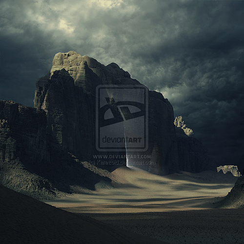
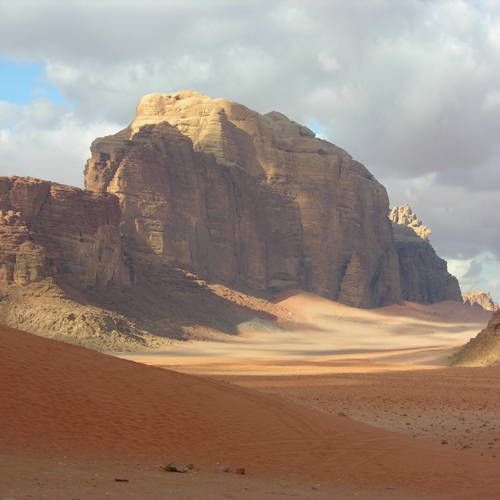
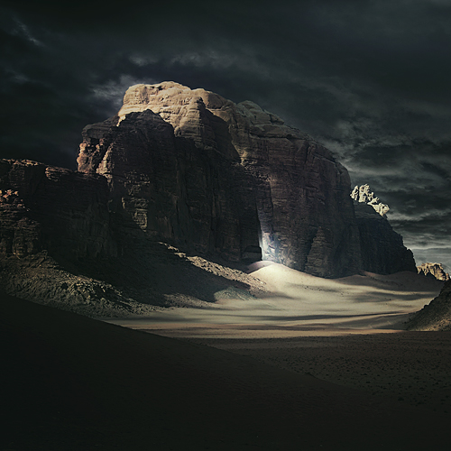

I have spent some time looking at my favourites on deviantART, and in particular, the work of Karezoid. I had mentioned his work in a previous post and decided to devil my skills and technical ability by looking at some of his pieces and trying to figure out how he’s had done some of the things which made them so effective.

One piece had a stock credit, which was rare, so I went and downloaded the exact stock image he had used so I could recreate what I can see. Obviously I know that I’m essentially copying their work, but I’m only using this as an academic example, and won’t publish it anywhere else other than my development blog. However, during the process of recreating something similar I learnt quite a lot, especially about how such simplicity can be rather compelling. Here is the original image by Karezoid:

I took the stock image he had used and used that as the basis for my own piece, I then tried to recreate the lighting and atmospheric conditions which are very apparent in the original. I then went on to experimenting with the intriguing lighting coming from the mountains. Here is the original image and my version:

I feel that I have learnt a great deal from this small exercise I’ve tasked myself with and it will definitely help me with my assignment. I usually try to identify the skill and techniques used in other pieces of work which inspire me and try to recreate them or at least search for tutorials on how to accomplish similar results.
