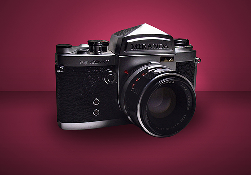
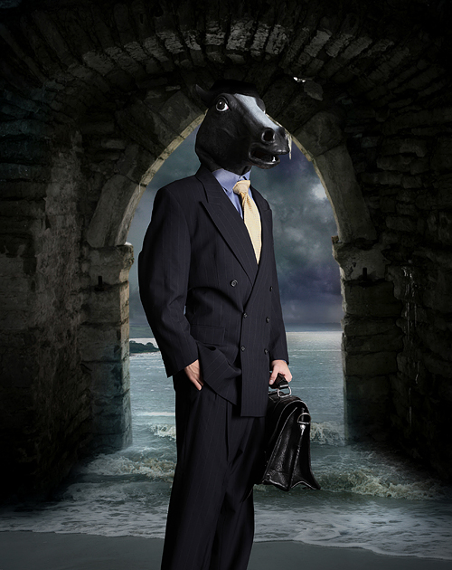
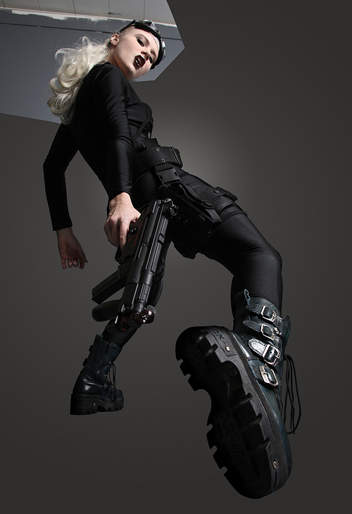
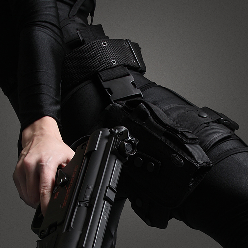

After using the brush tool and masks for background removal it was good to go back to using the pen tool, I have no used it very much for complex shapes, prior to these classes I had only really used it for cutting out pieces of furniture for my job.

However I think that was useful as it has allowed me to go around an objects rather quickly knowing how the pen tool behaves with it’s curves which can sometimes be a bit frustrating to get right.

Here is an example of a camera which had its background removal done with the pen tool, I also used an adjustment layer for curves to lighten it up for the shadows because it became difficult to tell where the camera ended and the shadow began.

I also added my own background so it looked more like a product shot, which are clean and simple. This can be useful when isolating photographs of small objects for use in advertisements, publications and for internet use.

Next I removed the background of the strange horse man thing and used a pre-made background from deviantART to give it a bit of atmosphere. It was also useful in terms of determining the lighting and the edges of the subject.

For instance it would look back if there was a slight halo on the edges where there was once a strong light source, a small about of dodge and burn fixed this, however I would like to know how dodge and burn can be applied non-destructively as it’s difficult to replicate the results using adjustment layers.

Later on I went on to removing the background on the female figure from the stock we have to use for the main project. I did this as practice using the pen tool on complicated shapes and also it means I won’t have to do this later when it comes to producing the final piece as I know that image is one of the ones I have chosen.

One of the problems I came across was removing the hair in a clean and crisp way like I have seen in professional pieces of work. I was unable to accomplish this using the methods I already know of and I aslo couldn’t quite get it to be of a high enough standard using the refine edge tool in CS5. The results were a lot better, but I feel there is something I could further learn about using it that can produce better results.

There was also a very faint and unnatural halo effect going on in the image when given a dark background even though I had gone in a few pixels when going around it with the pen tool, again I used some dodging and burning in the problematic places to get a clean crisp and realistic edge.

I still think however that there are probably better techniques and ways of dealing with this. One of things I discovered when removing the background on this is saving the paths you create with the pen tool. After spending a very long time going around it meticulously, I wondered if there was a way of preserving the path, and by going to the paths tab in the layers palette, you can give the working path a name, thus saving it for later use. This is especially useful if the path is long and you want to come back to it later or edit it.
