We were given the task of removing the background of a stock photograph of a model and had to create a background ourselves to create a scene. I first began looking through my collections I had made, picking out some that caught my eye. Having lots of collections on websites such as deviantART and Béhance has dramatically helped my creative workflow. I wanted mine to be black and white as that brought across a certain feel and atmosphere, additionally I liked some of the abstract scenes I was seeing.

I took particular interest in Karezoid’s work, it is rather minimal in its approach and barely looks like a photomanipulation at all until closer inspection. A lot of their work is highly atmospheric, creating a sense of intrigue and evoking imagination which is something I want to bring across in my class exercise and also later on in my final pieces. I also looked at a few other photomanipulations and photographs and extracted the elements or ambiance that appealed to me regarding the overal design ideas I wanted to accomplish.

[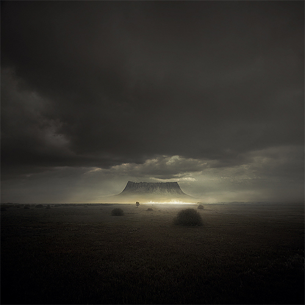](http://karezoid.deviantart.com/art/Plateau-II-163715155?q=favby%3Ajamessparkes%2F12686186&qo=315)

[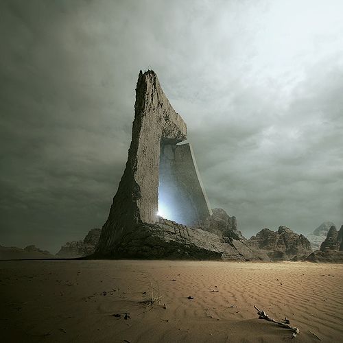](http://karezoid.deviantart.com/art/Blexen-124128699?q=sort%3Atime%20gallery%3Akarezoid&qo=179)

[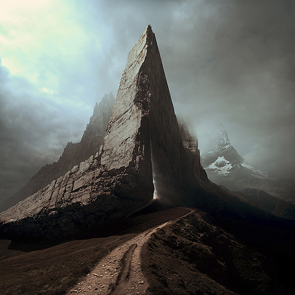](http://karezoid.deviantart.com/art/Oracle-256061877?q=sort%3Atime%20gallery%3Akarezoid&qo=5)

[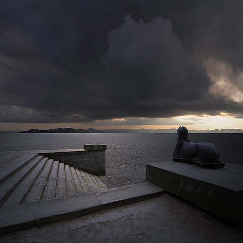](http://karezoid.deviantart.com/gallery/?catpath=/&offset=24#/d3bn8vr)

I will keep Karezoid’s work in mind later on for when I look further into my final pieces, and there are few other digital artists that take the minimal realistic approach that I have noticed. These pieces will serve as some good inspiration to come back to. Below is some other work that I took some influences from and will keep in mind for later:

[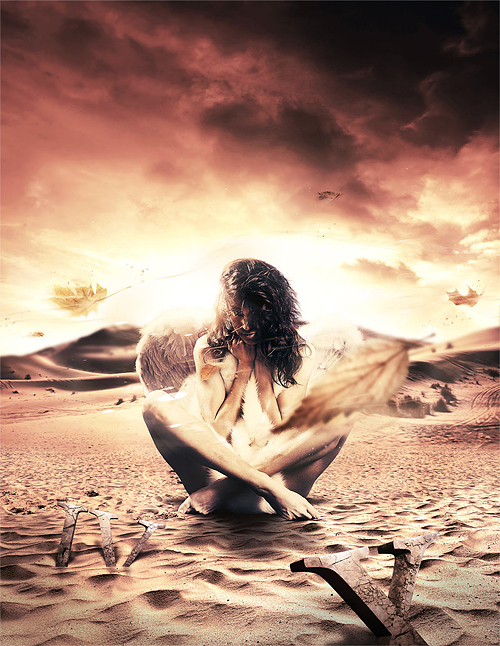](http://kevin-roodhorst.deviantart.com/art/Invasion-204504766?q=favby%3Ajamessparkes%2F12686186&qo=186)

[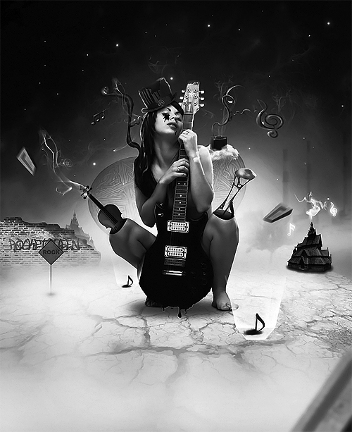](http://nofx-br.deviantart.com/art/Musician-Queen-131560063?q=favby%3Ajamessparkes%2F12686186&qo=49)

[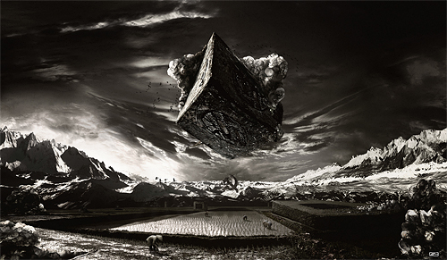](http://leox912.deviantart.com/art/Hammer-to-fall-256557778?q=favby%3Ajamessparkes%2F12686186&qo=488)

[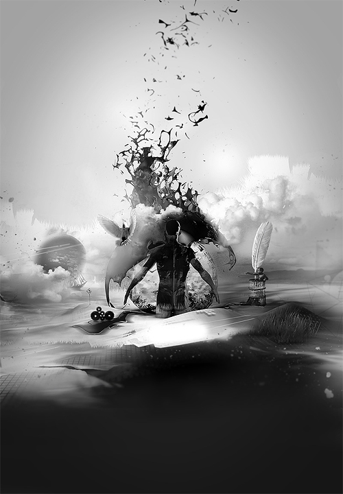](http://dopaminart.deviantart.com/art/Chess-Player-Roman-Noir-99309709?q=favby%3Ajamessparkes%2F12686186&qo=301)

[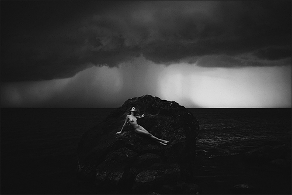](http://aleksandra88.deviantart.com/art/62389-257408209?q=favby%3Ajamessparkes%2F12686186&qo=304)

[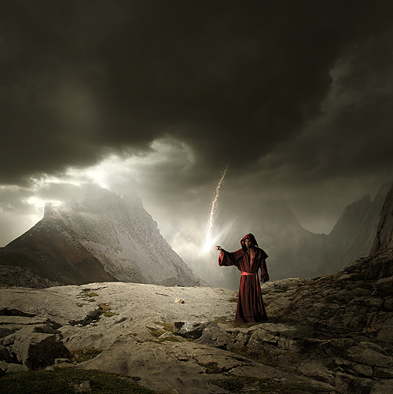](http://500px.com/photo/3152472)

[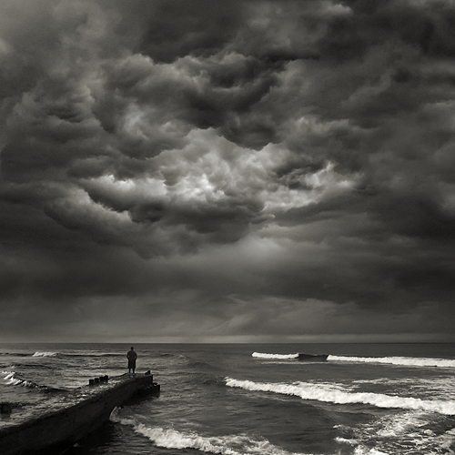](http://500px.com/photo/2956890)

[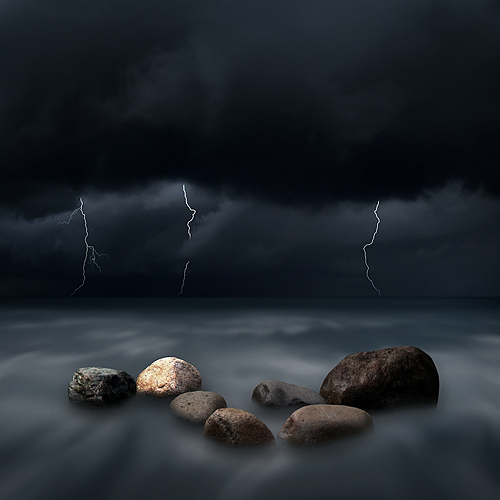](http://500px.com/photo/2091206)

Once I had a vague idea in my head I began searching deviantART for stock that closely resembled what I had imagined. It took a lot of time to find things that could work together compositionally and also the quality is often not very good. I’m not in the position of Karezoid and other digital artists who mostly to take photographs specifically for their work, however one day I’d like to source my own material so I have much more control over imagery.

I started off by removing the background of the model, placed that on a large canvas and began vaguely inserting rough cut outs of the stock I was gathering, when I was happy it worked, I then went back to the original image and removed the backgrounds properly, this saved a lot of time and I was able to switch between two similar elements and determine what I liked most. Another good technique I started using which I learnt through interface design, was converting things to a smart object. This meant I could scale it up or down without ever losing quality, and I could make as many edits and layers within this object without cluttering up my main document’s layer palette.

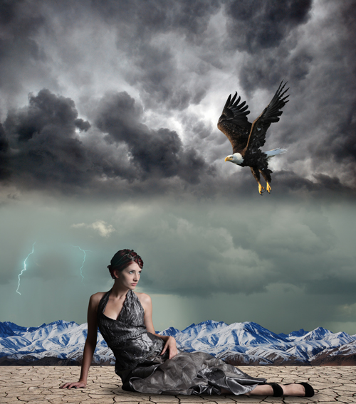

During the process of placing everything and composing the scene, I was adding adjustment layers, continually tweaking them to get the right contrast and lighting, this was made a lot easier by choosing to make my scene in black and white. This meant I didn’t have to spend to much time colour correcting and could focus on tonal adjustments. I found this a lot more helpful to begin with as I have yet to learn proper colour correcting techniques. As you can see from the work in progress above, it would have take a lot longer to correct each element to it looked like it belonged. I also think the black and white brings across a much more effective atmosphere and works better in this case.

[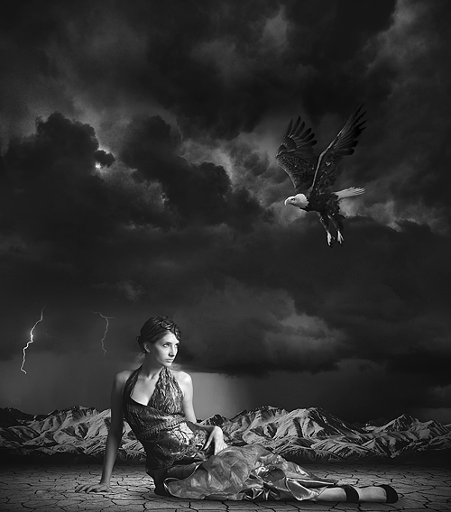](http://jamessparkes.deviantart.com/art/Desert-Eagle-269033767)

When I felt there wasn’t much else I could do, I saved a flattened version which I could resize and make any additional adjustments so it looked good at a small size, such as localised sharpening and some dodging and burning.

**Stock Used**

[Model](http://mjranum-stock.deviantart.com/art/Grey-on-Grey-1-212327270)  
[Eagle](http://equinestockimages.deviantart.com/gallery/31769208#/d429l5l)  
[Desert Floor](http://browse.deviantart.com/resources/stockart/?qh=&section=&q=desert+floor#/d2s1rst)  
[Mountain Range](http://browse.deviantart.com/resources/stockart/?qh=&section=&q=mountains#/d18vc5l)  
[Lightning](http://browse.deviantart.com/resources/stockart/?qh=&section=&q=lightning#/d1268ki)  
[Rain Clouds](http://browse.deviantart.com/resources/stockart/?q=rain%20clouds&order=9&offset=24#/d28i4m4)  
[Storm Clouds](http://browse.deviantart.com/resources/stockart/nature/skies/?q=clouds&order=9&offset=48#/d3hdlhm)
