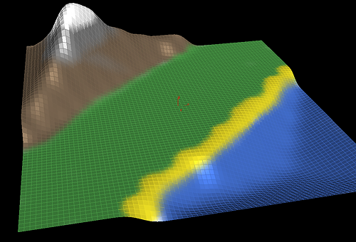

Here is an example of using groups in Houdini to create a simple landscape. This is accomplished by selecting an area of points where you want to make you deformation to a grid, grouping them with Group Geometry, and adding a Soft Transform to create raised and lowered parts.

This is a very quick way of doing some landscaping such as mountains, lakes and extruding objects out but keeping a ‘stretched fabric’ form to them which can be useful in modelling. A Subdivide was added later in order to have more control over specific areas. Growing and shrinking the selection of the points also came in good use for this task.

Another area we looked at was the Paint SOP, in this instance we used it to add basic colour information to the terrain so we can tell easier what part is what, such as blue for water, green for level ground and brown and white for the mountain. This is useful for when you want a general outline of what is what without rendering, but the Paint SOP can used in an even more powerful way, as you can paint certain areas of something with a specific colour and that colour can provide information to something else in Houndini.

This means it can add trees in that certain area, or as the colour decreasing a certain element begins to get smaller and smaller, which would be of use in complex structures where you don’t want to model minute details when the placement of a colour can translate that information for you.
