I have recently been looking at a lot of landscape matte paintings, mostly for inspiration for 3D class, but also in preparation for the digital painting part of Photomanipulation class. I appear to mostly be drawn to a fantasy or science fiction theme regarding the style I’d like to achieve. This should relate to both classes as I’d like tie them both together since, the final 3D production will need to be finished in Photoshop, as it’s rather rare for something to be entirely generated and entirely finished within a 3D programme.

I would like to test my skills and aim for something ambitious so I have been looking at some artists who have an incredibly high skill level, something I’d like to be at one day. These examples show a combination of 3D, digital painting and photography, so they are well suited to serve as inspiration for a broad range of skill sets. Additionally, the imaginative landscapes shown here are exactly what I need to help me generate ideas for my final 3D piece.

[**Andreas Rocha**](http://www.andreasrocha.com/)

[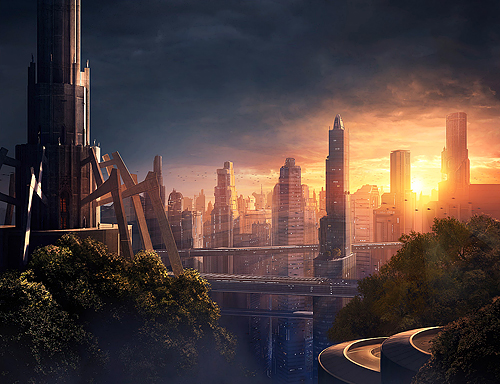](http://www.andreasrocha.com/gallery/digital/images/091119urbanlights.jpg)

[**Yohann Schepacz**](http://www.oyoz.blogspot.com/)

[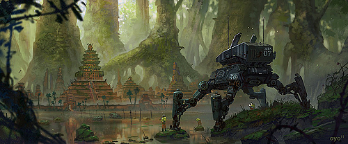](http://1.bp.blogspot.com/-VR39BO13GaI/TkJQCyHtCFI/AAAAAAAABH0/1N8_p1H4xRk/s1600/scifikortez_oyo_w.jpg)

[**David Lee**](http://cityhunter.cghub.com/)

[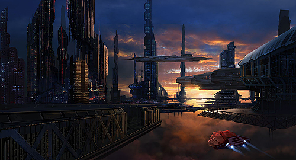](http://cghub.com/files/Image/145001-146000/145846/067_max.jpg)

[**Zhang Yixin**](http://esin.cgsociety.org/)

[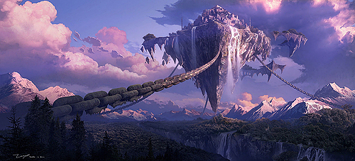](http://features.cgsociety.org/newgallerycrits/g76/296276/296276_1307545520_large.jpg)

**[Levi Hopkins](http://levihopkinsart.blogspot.com/)**

[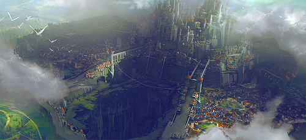](http://4.bp.blogspot.com/-2XjWeKbJiKs/Td6ZAnuWbhI/AAAAAAAAAGI/O9noIAweFMs/s1600/DivinitySinkholerDistrictSketch.jpg)

**[Yi Ming Xuan](http://blog.sina.com.cn/fanming2008)**

[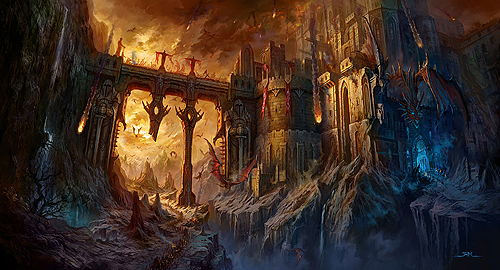](http://coolvibe.com/wp-content/uploads/2011/04/fanming4.jpg)

[**Gaetan Weltzer**](http://www.portfolio.designspartan.com/)

[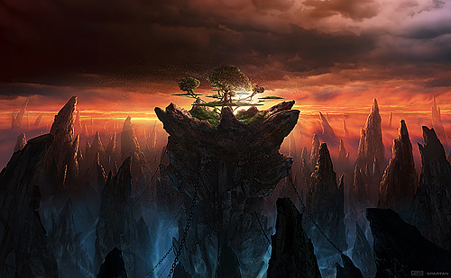](http://www.portfolio.designspartan.com/full_images/last_world.jpg)

[**Christian Gerth**](http://chrigi76.deviantart.com/)

[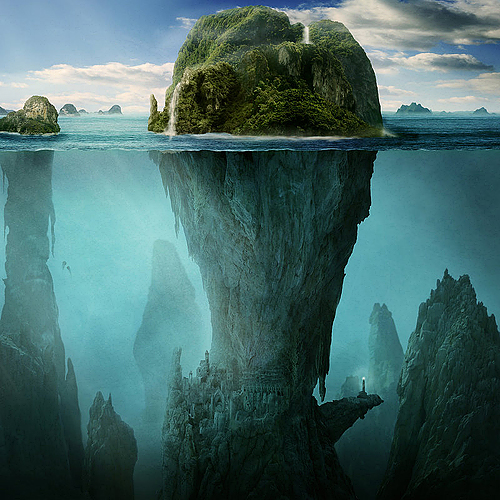](http://fc01.deviantart.net/fs70/i/2010/323/b/8/the_sunken_village_by_chrigi76-d32yil2.jpg)

[**Jan Ditlev Christensen**](http://www.janditlev.com/)

[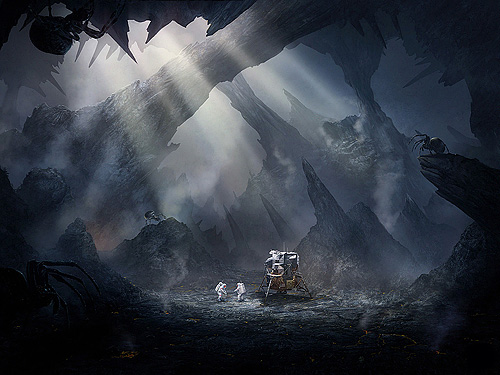](http://3.bp.blogspot.com/-RdAy4DnNGy0/Tnem_gnqMuI/AAAAAAAAEHM/pvRcKvjsyvQ/s1600/008.jpg)

**[Jesse van Dijk](http://www.jessevandijk.net/)**

Another artist I looked at was Jesse van Dijk They do concept art for films and video games, and one of their projects was intriguing as it had a comprensive entry about the story behind the design and some stages leading up to the finished piece where you can see how the different elements come together for the end result:

[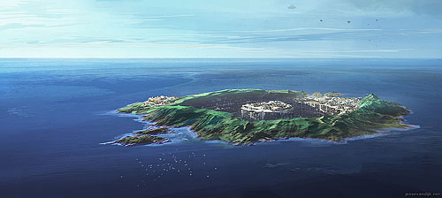](http://www.jessevandijk.net/g_08_76.html)

[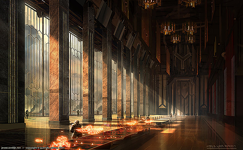](http://www.jessevandijk.net/g_11_18.html)

[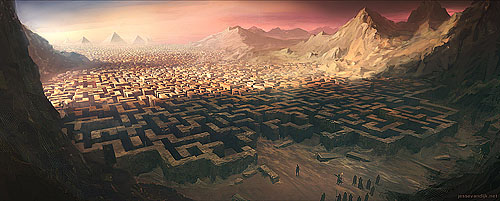](http://www.jessevandijk.net/g_07_20.html)

[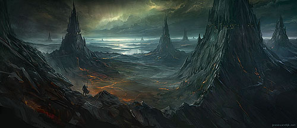](http://www.jessevandijk.net/g_08_05.html)

[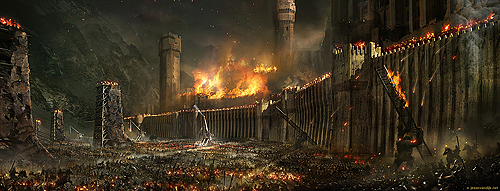](http://www.jessevandijk.net/g_10_20.html)

**[Dylan Cole](http://www.dylancolestudio.com/)**

Dylan Cole’s work was particularly noteworthy as he has worked on films such as Lord of the Rings, so I was immediately drawn to them. They incorporate a broad range of techniques such as miniature photography, digital painting, photomanipulation and 3D. He has also produced tutorials and co-authored the book [d’artiste – Matte Painting](http://www.ballisticpublishing.com/books/dartiste/matte_painting/) which I would like to look at some time to gain knowledge of the artist processes he goes through to create his work.

[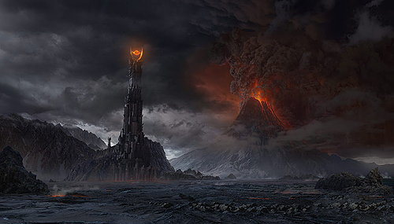](http://www.dylancolestudio.com/)

[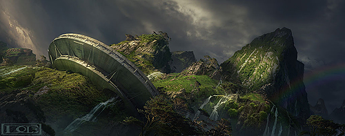](http://dylancole.deviantart.com/gallery/#/dgsop2)

[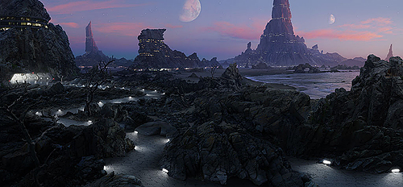](http://dylancole.deviantart.com/gallery/#/dag5i3)

[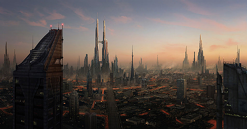](http://dylancole.deviantart.com/gallery/#/daf517)

[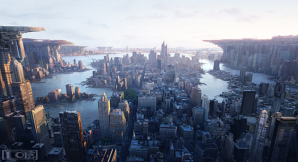](http://dylancole.deviantart.com/gallery/#/dag59e)
