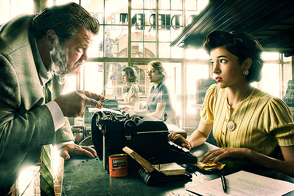
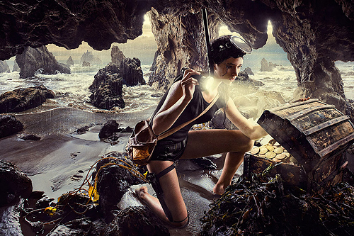
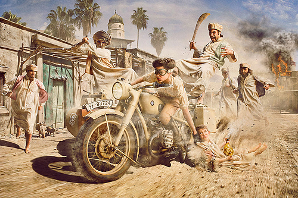

I had mentioned earlier about how it would be ideal to take photographs myself or have photos specifically composed to be manipulated. Doing this can create a bigger and more comprehensive scene that otherwise wouldn’t be possible to capture in a single photograph.

You can see this in [Dave Hill’s work](http://www.davehillphoto.com/), the composition can be controlled precisely and it is clear there is a lot of art direction going on behind the scenes of each photographs which acts almost as a still from a film telling an elaborate story. Below are a few examples from his [Adventure](http://www.davehillphoto.com/adventure/) series:

And below is a video showing an exploded view at a few of the layers that make up the images. It is very insightful to see what goes into making pieces of work like this and how complex they details can get, especially when you have [full artistic control over the photography](http://vimeo.com/5082148) and content of the scene.

<a class="video-embed" data-provider="youtube" data-id="kALDKs0DmbI" href="https://www.youtube.com/watch?v=kALDKs0DmbI">Play video</a>
