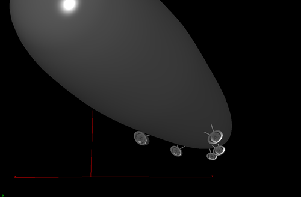
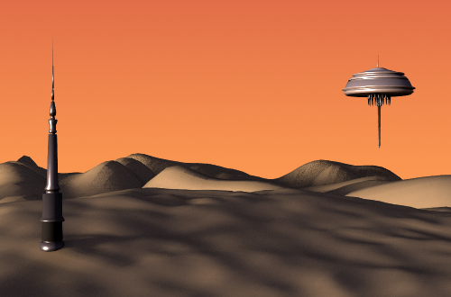

During production of my landscape I had made several attempts, usually reaching a point where I was unhappy about something and starting again, through this I felt like I had been able to speed up some aspects of creating things I wanted, as I had already done it before. All I had to do was start again and do it again, but better. I did this a few times with the ground and mountain range, and also tried a few variations of the space ship, I looked at making it look more like the Cloud City from Star Wars and even considered making a large airship. I feel the airship may have been able to utilise the Copy SOP but I was unhappy with the overall shape and how it might look in the final composition.

I also experimented with lighting in these earlier versions. I tried various lights and watched a few lighting tutorials on Vimeo and YouTube to get a better insight into how to use the lights more effectively. One tutorial briefly covered the Sky Light, which is an environment light that encompasses a sun and an overall environmental ambiance. This light in particular captured my interest as it produced what I thought were very realistic lighting but with some atmosphere as it simulated a sun which you could set the parameters to be positioned at a certain time and position in the sky. I really liked this as it meant I could give it the longitude, latitude and time so that it gave the type of lighting I envisioned, in this case a late evening time casting strong shadows across the geometry, almost a backlit scene but still high enough in the sky to retain details.

I had tried many other ways of lighting but none of these produced results I liked, they were either far too strong or they completely saturated the scene with light taking away any finer details of depth away from everything. I had known for a long time that lighting will be a very important key aspect to the overall look and feel of the landscape and I wanted to invest time in making it look the way I wanted. The only problem I had with this was that it caused a strong grain to wash over everything, however after asking a few people in class if they knew any solutions, it became apparent that the sampling quality was in both of the lights and I was only adjusting one of them. Overall I think my solution to lighting was rather basic and that I could learn a lot more about it.
