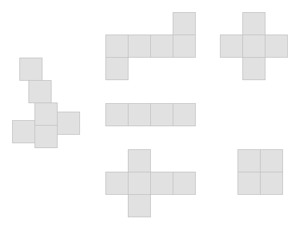

Here you can see how I have looked at various combinations of placement for the four to six squares required for the final project. I am still looking at exactly what I want to convey on my squares, but I have a few ideas regarding some aspects of the nuclear power debate. I could explore the idea of nuclear power not being entirely understood by the public as a whole, and I have thought about perhaps the squares arranged in a way that when folded up they made a box, and that box is opened one square at a time revealing the quote and design.

Another design I may explore would be that of having the squares arranged so they vaguely resemble the UK and have small shapes symbolising the nuclear power stations around the UK, and have lines representing power lines, and then somehow work the typography into that. However I have looked at having a ver simple layout, such as a square, or line and focus only on how I will utilise the space on the squares instead of the shape being a prominent element to the overall design.
