I was browsing through [my favourites on deviantART](http://jamessparkes.deviantart.com/favourites/) and decided to pick out a few that have given me ideas on what I might create for my final 3D piece. After looking at looking a lot of landscape work, I started looking at more sci-fi related art, things which incorporated large scale spacecraft or cities, as that kind of thing appeals to me. I was thinking of putting these two together and producing a mountain scape with a large floating spacecraft somewhere in the frame, possibly in the distance so it’s still clear that it’s the vista that is the main focus.

I looked at fascinating mountain and rock formations, and interesting environments for some inspiration. Since I can create this vista from scratch, I’d like it to be wondrous and awe-inspiring, bringing across a sense of a huge scale in the scenery. Additionally I came across something clearly inspired by the Lord of the Rings, and that got me thinking about the vistas featured in it. I had [previously looked at Dylan Cole’s work](#2011-11-19-inspiration-3d-and-matte-painting-landscapes), who did some matte paintings for the film. The way Minas Tirith is portrayed in the film is particularly influential to me as it is such an intriguing structure. I could, if possible, include something inspired by it within my mountain scape.

[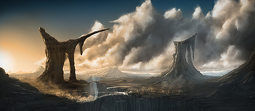](http://edlo.deviantart.com/art/LAND-WITHIN-256577577)

[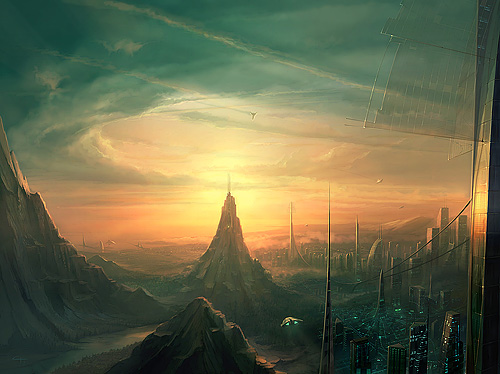](http://antifan-real.deviantart.com/art/BASILICA-12698722)

[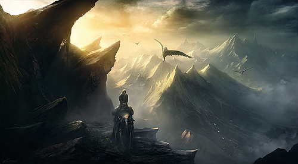](http://korbox.deviantart.com/art/Induco-259839197)

[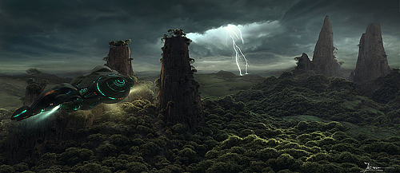](http://max4ever.deviantart.com/art/TerraNova-print-70379748)

[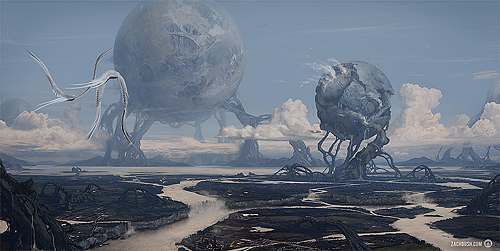](http://zbush.deviantart.com/art/Genesis-131497174)

[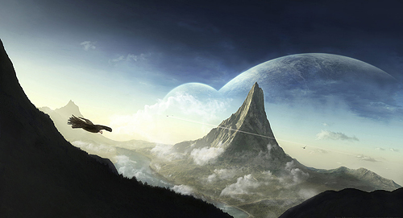](http://gucken.deviantart.com/art/Untouched-86600987)

[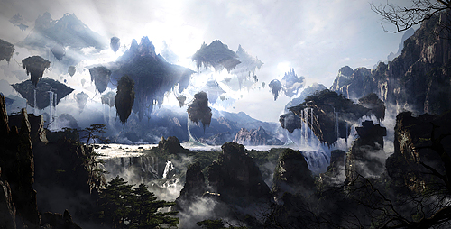](http://jjasso.deviantart.com/art/Dranon-Falls-216975384?q=gallery%3Ajjasso%2F2573003&qo=1)

[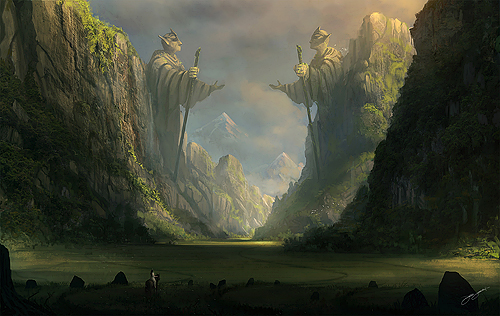](http://blinck.deviantart.com/art/Through-the-ancient-valley-188917591)

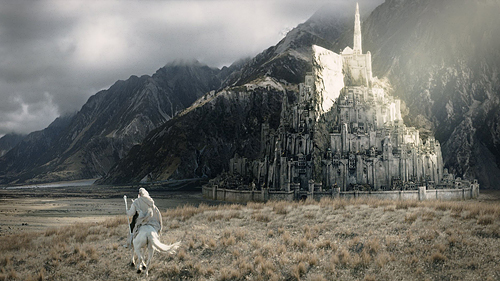

I have also be inspired by large spacecraft or aircraft, suspended motionless in the sky, such as Cloud City and the Star Destroyers in Star Wars and the space ship from District 9. I want to make a scene which looks like it is part of a bigger universe, where the viewer can see there is vast world behind the image as though it is a snapshot in a film or something. I am also looking carefully at the angles which show the immense size of these objects well, as to carry through these feelings I want to convey. Additionally, I’ve been looking at clouds in the sky as sometimes they resemble large floating spaceships and also airships.

[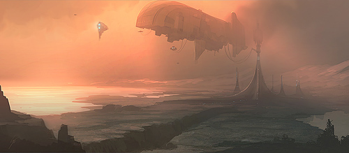](http://antifan-real.deviantart.com/art/SP-Off-World-Refueling-185892980)

[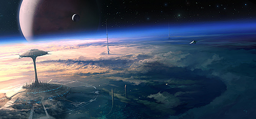](http://antifan-real.deviantart.com/art/Orbit-Redux-90630620)

[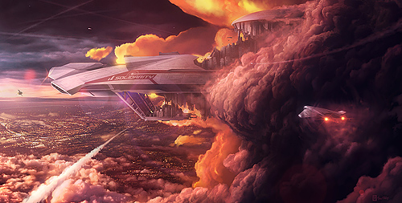](http://rahll.deviantart.com/art/Solidarity-174240064)

[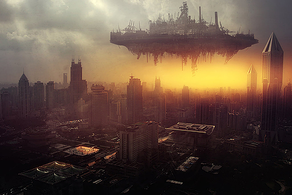](http://shadowelement.deviantart.com/art/District-10-139600141)

[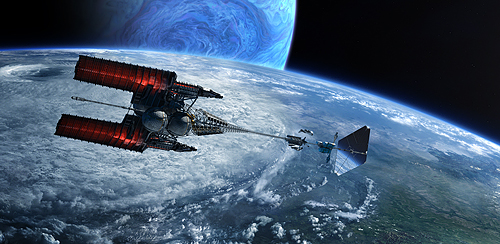](http://jjasso.deviantart.com/art/AVATAR-2-151644994)

[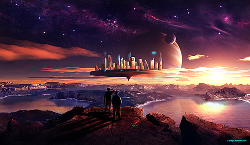](http://z-design.deviantart.com/art/Homeworld-Ordalla-148665275)

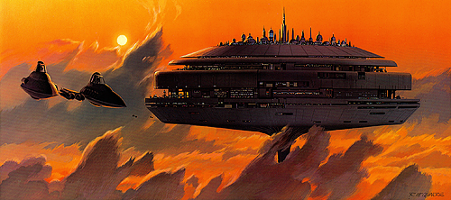

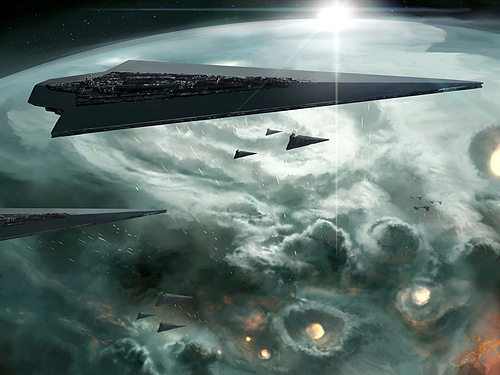

I think that these elements could be created in Houdini given that I put in enough practice, and that my skill increases enough before the final project is due to the level where I can make what I envision to a high enough standard. I have experimented with making mountain ranges, airships and airplanes, so given enough time I should be able to take those skills and apply them to something a lot more ambitious.
