In order to get a better idea of where to go for the branding of the collective and how to carry out the task of conveying the group’s values I have been looking at various examples of branding and logos for inspiration and how designers have tackled conveying someone else’s values or their own.

It is good to see how branding is constant across all forms of mediums that a company or collective such as ours would be using, we aren’t tasked to create anything to this extent for the assignment but I would like to take some design aspects from a few of them and some ideas and possible incorporate them into this assignment or keep them for reference later on.

[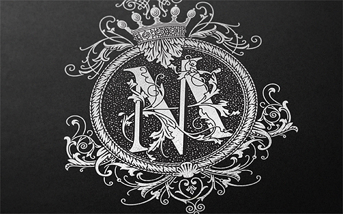](http://www.behance.net/gallery/Melchior/706290)

[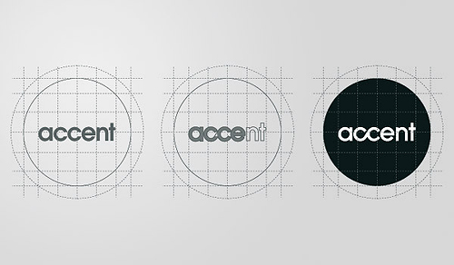](http://www.behance.net/gallery/Accent-Creative-Identity/750400)

[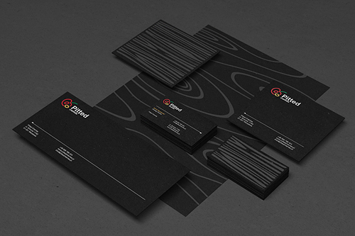](http://www.behance.net/gallery/Pitted-Cherries/2518777)

[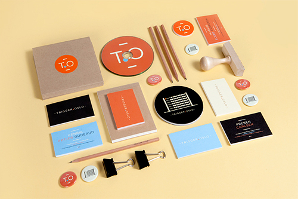](http://www.behance.net/gallery/Trigger-Oslo-Identity/1066863)

[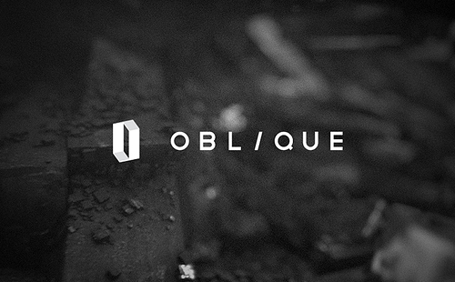](http://www.behance.net/gallery/Oblique/758196)

[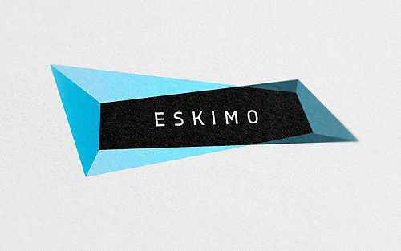](http://www.behance.net/gallery/Eskimo/806424)

[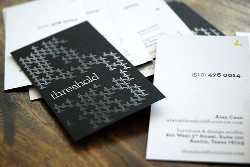](http://www.behance.net/gallery/Threshold-Furniture-Design/720916)

[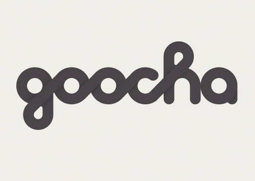](http://www.behance.net/gallery/Goocha-Brand-Identity/707641)

[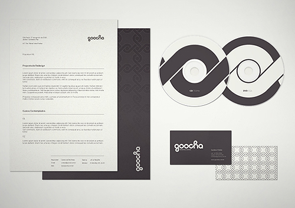](http://www.behance.net/gallery/Goocha-Brand-Identity/707641)

[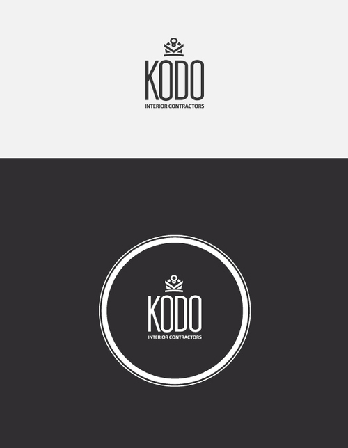](http://www.behance.net/gallery/KODO-Interior-Contractors/305418)

[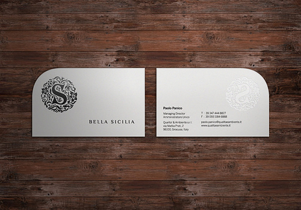](http://www.behance.net/gallery/Bella-Sicilia-Identity/245814)

[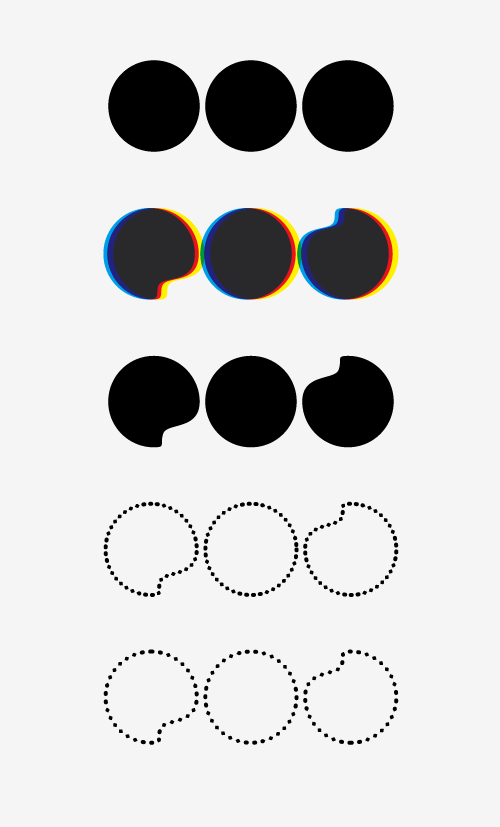](http://www.behance.net/gallery/POD-a-Camps-Bay/679515)

[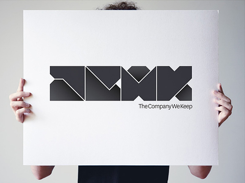](http://www.behance.net/gallery/The-Company-We-Keep/754571)

[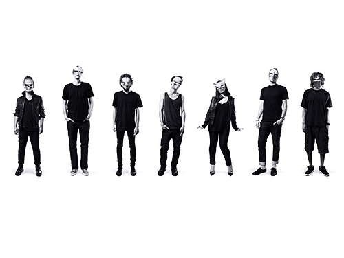](http://www.behance.net/gallery/The-Company-We-Keep/754571)

[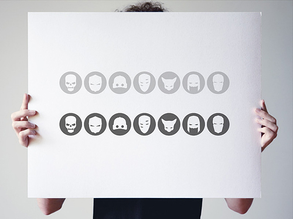](http://www.behance.net/gallery/The-Company-We-Keep/754571)

It is clear from these examples and many more I have seen that the identity of the collective and the personality of the group’s members should in some way show in the visuals that convey the hypothetical company, as that is where the values stem from. It is clear through good design what the values of companies are and what they are telling people since it is vital clients undertsand this when they make a choice of what design company or agency or freelancer to work with, as the values have to be similar in some way or at the very least be complentry, otherwise desing decisions, ideas and interactions may be difficult.
