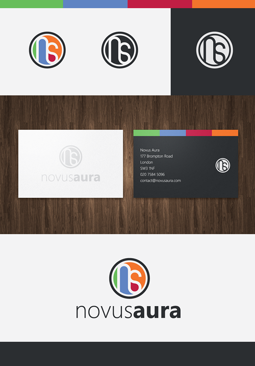
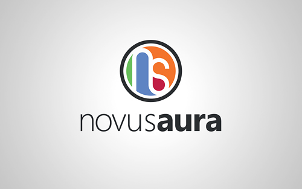

After various meetings with my team members we came away with the values and a clear idea for what the collective does, in addition to this I was given the task to come up with a logo. I came up with a few ideas preceding our duscussins and the ideas we generated together, which I showed Tia and Rich and we decided on the final logo. In order to give a better sense of the identity we were trying to bring across I created an example of some uses for the logo and how it can be used in certain instances such as on black or white backgrounds.

And here is the logo by itself which will feature in the final animation:

I feel that overal look and feel to the logo conveys the ideas of clean and modern with a strong creative side coming across from the bold colours featured in the logo. The colours would also be used throughout various elements of the collective’s branding and visuals.
