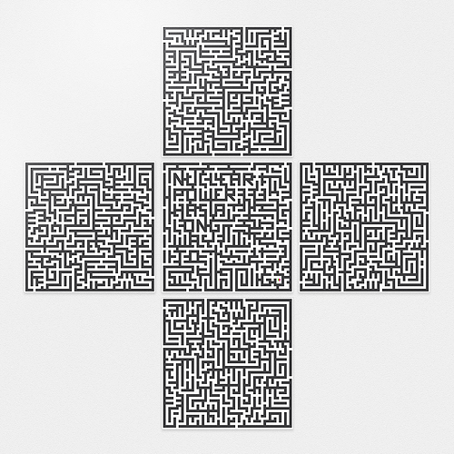

I have been conducting some research into what I can use as my quote for the final piece, I looked back through the research I conducted at the beginning for some quotes which may help me with the design of my four to six squares. Here are a few of the quotes I looked at in particular:

*   All the waste in a year from a nuclear power plant can be stored under a desk.
*   Nuclear fuel is virtually unlimited and packs a huge energy punch.
*   Nuclear power offers the only alternative to fill this impending energy gap.
*   Nuclear power has a long way to go.
*   Nuclear power is the way forward.

Eventually I decided to go with “Nuclear power has a long way to go.”, as it is a positive quote in my opinion, but it is rather humble. I think that it a rather fitting quote as it shows that as much as some people want nuclear power to prosper, it will have negative connotations with the public, and until nuclear power circumnavigate these obstacles it won’t ever be accepted by society fully.

After looking through [my Behance favourites](http://www.behance.net/collections/view?collection=2689754) and seeing a few pieces while considering my quote I found some which resembled a labyrinth. This to me was a very interesting concept I wanted to explore because it represents the long and winding road that nuclear has to traverse in order to become a source of power that people take seriously, it also is still a type of energy that is still in development, so there are so many paths it can go down as it emerges as something that may replace other technologies in whatever form it takes in the future.

So i thought about the design for a while and began working on it. After some experimentation I had finalised my idea and the placement of the squares. I wanted them to be arranged in a way that was uniform, I also didn’t want them arranged in a way which had no meaning, so I had central square with the other squares attached to each edge as it was one of the most logical arrangements I could think of with the outer squares converging in on the centre square, framing it, showing that it is the focal point.

The labyrinth design itself is also a metaphor for the long and troubled road it has already lead, with public support for it fluctuating with the kind of press it receives and how it presents itself to a wide audience of people who are divided on opinion or who may already possess a strong opinion. Here is what I envision it would look like arranged and suspended on a wall of some kind:

The reason why I chose to make it look like it is printed on paper is because the idea of nuclear power is still technically on the drawing board. There are still so many things they need to figure out in order to make it cheaper and safer in the view of the opposition. Ideally I’d like it printed on a think matte paper so I have simulated this as the results cannot be recreated cheap enough for me at the current time.

Another way of looking at it is taking the composition as a whole and thinking about its complexity relating to the large scale complexity in nuclear power generation but in upon closer inspection of the process it is very simple, much like the complexity of the labyrinth compared to the simplicity of getting from one side to the other.
