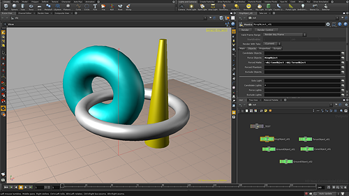
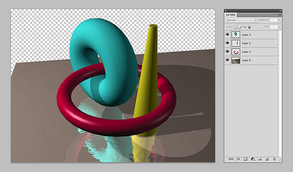
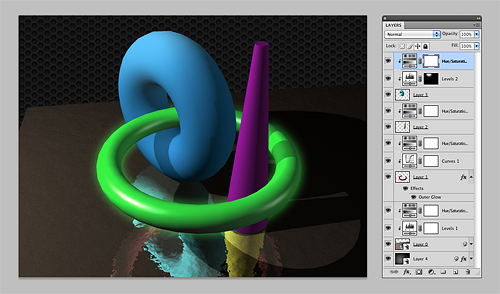
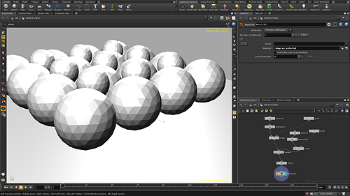
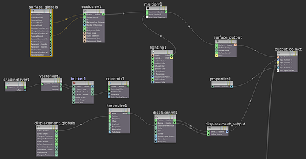
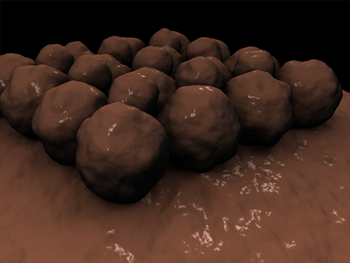
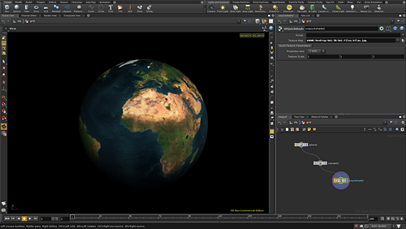
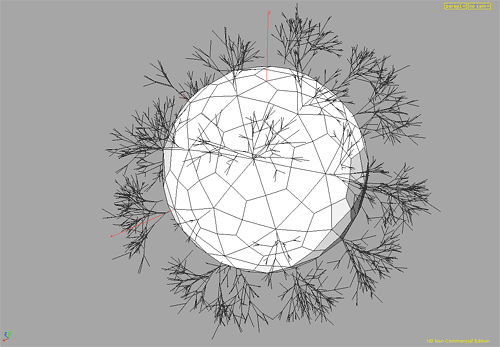
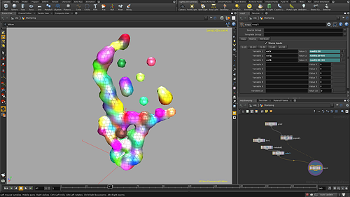
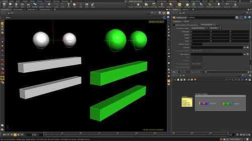

Throughout the term in class we have undertaken small exercises in order to get familiar with some of Houdini’s basic functionality and capabilities. Some of the exercises demonstrate some powerful features which I can utilise in my final assignment where I will create some sort of abstract landscape.

Here is example of compositing using Houdini, each object is rendered out separately with or without shadows or reflections. They are they saved as individual images that can be brought together in Houdini or Photoshop to undergo further refinements which may be too time-consuming or inefficient to be produced within Houdini.

Here is what the exported images look like when imported into Photoshop, this is a good way of adding elements that I may no be able to produce in Houdini for my final piece. This is a quick example of some of the changes which can be accomplished with the isolated 3D elements:

These adjustments are possible in Houdini using tools much like what you would find in Photoshop, however I am much more comfortable with working in Photoshop and it would be easier to add effects and other refinements in a post production environment rather than finding ways of accomplishing the same results with Houdini. Another advantage to this is you wouldn’t need to render the entire scene at once, cutting down on the time I’d be waiting for it to be useable in Photoshop.

Another technique we learned was occlusion, which gives the render a realistic look by calculating where light rays would bounce off and illuminate other parts of objects. We applied this to a material which we had our objects plugged into.

Here is how the material was set up, there are many other parameters which can be adjusted giving various different effects. Utilising turbulence noise we were able to create meat/poop balls depending on what colour we gave the objects:

We also looked at projecting a texture onto shapes such as flat surfaces and spheres. Using UV Project and a Quick Shade projecting an image created a rudimentary texture for the object, however this is limited as it was dependent on being projected directly onto the surface, for more complex geometry a UV Pelt would be needed which would generate a mesh in which a texture is laid out like a taxidermists animal skin, so images wrap correctly to the geometry.

Here is another exercise which demonstrates the Copy SOP being used to populate a small planet with trees created using L-Systems, which can be manipulated in many ways. A Stamp in the Copy SOP was used to create a variation in the size of the tree and it’s branches as well as other parameters such as rotation so the tree always looks different every time, making it easy to create a forest or a large area of trees or plants, for some reason they are animated to sway in apparently strong solar winds bombarding the tiny planet:

Additionally we learnt to use a Particle Network or POPnet to generate particles from a small area, various parameters control them such as how long they can live, their frequency and how they behave. A Metaball was then copied to each particle making an oozing colourful gloop ejecting from the origin of the particles. Anything could be copied to each point made by a particle, such instance; penguins, Hobbits or light, meaning a great deal of particle based effects can be recreated.

Finally we looked at parenting geometry so that objects can all be manipulated at once, meaning the top geometry has it’s parameters shared with the subsequent geometries which are connected to it. This will be useful when moving large amounts of objects that have their own geometry.

Over the past few months I believe I’ve learnt a lot about Houdini and how it operates, however a few of the things I have forgotten how to do precisely, but I will continuously look at tutorials and the online documentation for any problems that I incur during my journey through the creation of my final piece. Some of the terminology I had to make note of as they all begin to sound similar and it is good to have a reference as to not get confused by the different operators such as:

*   SOP – Surface Operator
*   SHOP – Shading Operator
*   COP – Composite Operator
*   VOP – VEX Operator
*   POP – Particle Operator
*   ROP – Render Operator

Some of these exercises will certainly come in useful as I look back at what I have done to help me construct my abstract landscape scene.
