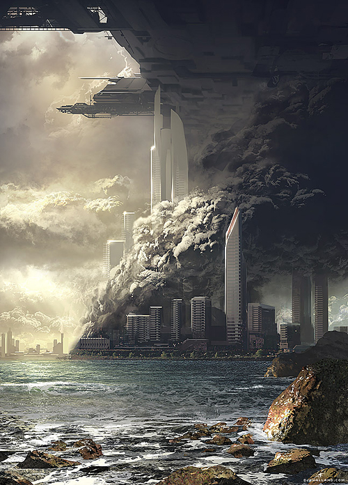
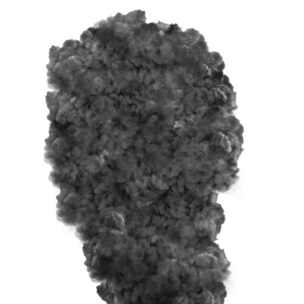

Looking at my inspiration, one of the most predominate thing I wanted to include was billowing distant smoke, much like [I had looked at previously](#2011-11-13-composition-experimentation) as well as this piece I saw in addition to the others:

However I was finding it difficult to find a technique of doing this well. I had tried using stock images of smoke to no avail. These would end up having unsightly halos around them as it was impossible to completely irradiate the background. Not even using refine edge in CS5 could make them look any better. I then went back to my first idea of looking for a brush and found one which produced the most realistic smoke plumes I had seen a birch create. Here are some of the tests I did using the [brush set](http://browse.deviantart.com/resources/applications/?q=smoke%20brush#/d1b9daq) made by [Wen-JR](http://wen-jr.deviantart.com/):

It took some time to get the technique right, but after a while of experimenting I discovered if I painting in the smoke using the brush and then duplicating the layer and inverting the colour, and setting them to overlay brought out some details in the smoke, I then, using a different smoke brush erased out or put back in highlights or shadows as I went around it making it look as realistic as I could.
