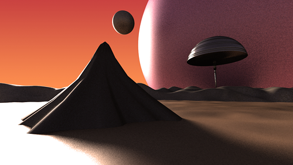
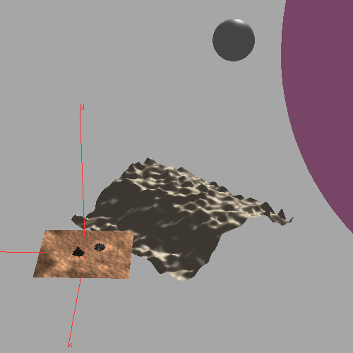

From the start after looking at a lot of other pieces of work such as scenes from films and concept art I had a good idea of the composition of the final product. I wanted to have a standard film aspect ration so I set up my camera to be 720p which meant that I could easily change it to 1080p or quad full HD later when I would be rendering out properly. This ensured that my scene was always positioned exactly how I wanted while being able to override the output resolution at anytime I wanted.

Another aspect which featured in a lot of the things I looked at was mountains, they are huge monolithic natural structures that create a sense of wonder and awe, and a lot of those works have captured these surreal visions of rocks and mountains. I think I could have made a better effort at making something more abstract, however it took me so much time just to make a normal mountain I thought I had better leave it for now otherwise I could be endlessly improving it and I knew I had to render it a while before the deadline which was different for me as I usually end up leaving things for the very last minute.

I tried experimenting with the cameras parameters to get different angles and perspectives of my scene, such as emulating some camera lenses I like such as a 14mm wide angle lens, and other focal lengths which weren’t quite extreme, however this caused my mountain to look rather weird and not quite so dramatic, making it look significantly smaller. If I had changed the positioning of objects and maybe had a different shaped mountain I think this could have been an improvement, but for now I will keep it in mind for later and keep it simple.

Again, I think a more extreme focal length could be better utilised in a different type of scene, perhaps a city or something which had geometry closing in on and around the viewer to create a sense of claustrophobia or to making small spaces look much bigger. However, I do think my camera placement does compliment my composition of the scene as there are a few sweeping lines and a triangle present which is pleasing to the human eye.

I think there is only one problem with how I put the scene together which was because I had very early on settled roughly on where the camera will be positioned, I had built up the scene in a way that looked like an entire landscape, but was composed of elements positioned so they looked like they were a whole at only that particular angle. For instance, if I suddenly decided I wanted a different angle and placed the camera somewhere else, it would be clearly seen that I placed various elements in space that are separate from each other. I’ve never seen exactly how scenes are put together professional from different angles so I’m not sure if how I’ve done it is incorrect or not, but that is one of the problems I did notice.

I feel that I took advantage of that one particular angle and tried to ‘hide’ that it wasn’t a full scene, which for me allowed a lot of flexibility since I could at any point reposition the background mountains to be in the shot if I change the camera slightly, but when I think about something on a bigger scale such as an animation perhaps, where there would need to be various shots from difference angles or heights, it would be difficult to go back and recreate the scene so it was one entire huge ‘whole’ environment.
