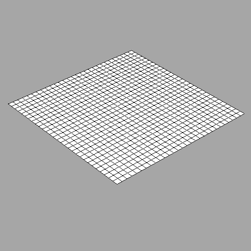
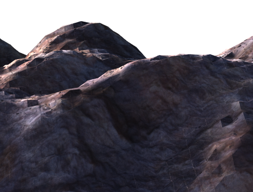
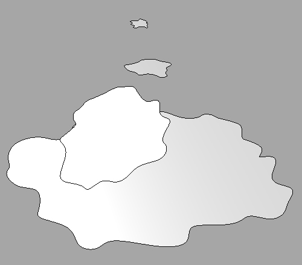
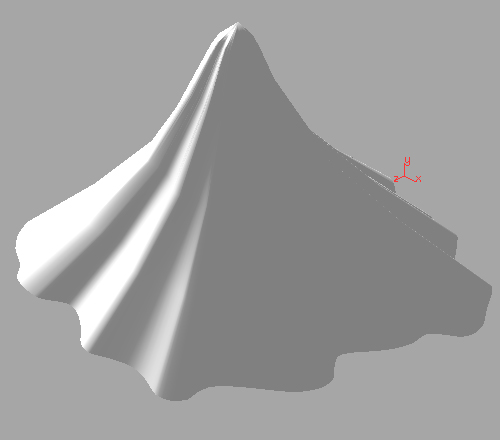
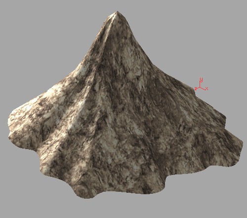

During the process of conceptualising my landscape I decided I wanted to have mountains, in particular a distant mountain range with a prominent larger mountain in the foreground. The background mountains didn’t serve too much problem in terms of modelling, I used a large grid, gave it a vast amount of divisions, made it very large to cover the full width of my camera’s view and applied the Mountain SOP and adjusted the parameters to get the affect I wanted, I then made it more realistic by adding a Subdivide, a Fractal and applying a texture.

This then posed some problems at render as it was showing unsightly artefacts and large triangular anomalies. After seeking help from Pete I decided that it would be better to remove the problem SOP which turned out to be the Fractal since time was running out and my renders take a very long time. I wanted to get my rendering completed ahead of time incase any other problems occurred before the day of handing it in and I wouldn’t have time to carry out an additional render of the mountains.

The other mountain, one of the focal points of the scene was highly frustrating during the modelling process. I wanted to create a realistic shaped of a mountain which the Mountain SOP couldn’t accomplish. After many attempts of modelling the mountain in different ways from using the Sculpt SOP on a large grid, to trying to make a large pyramid and subdividing it then sculpting it, I settled on using a method which involved using a Curve to make several differing flat shapes that when stacked and giving an equal distance in height from each other they made the framework for a mouthing. A Skin SOP was then added to give the mouton shape, I then adducted the position of the flat shapes to form it into a simple mountain.

I would have liked to have the knowledge of how to modelling things more effectively as I feel that what I imagine is very difficult to translate using the tools of Houdini. I feel like I have barely scratched the surface of modelling in general which is interesting as I’m being restricted in terms of technical ability where what I want to create I need to acquire additional knowledge in order to accomplish seemingly very simple tasks each and every time.
