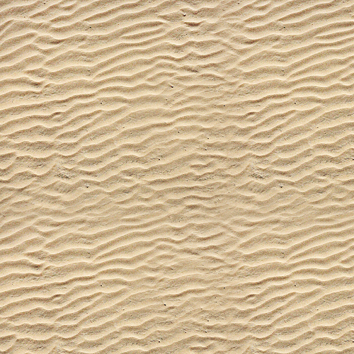
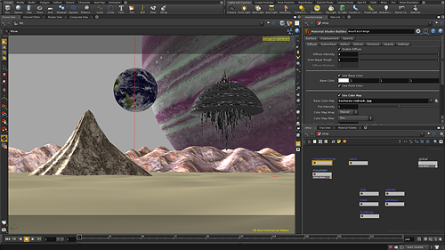
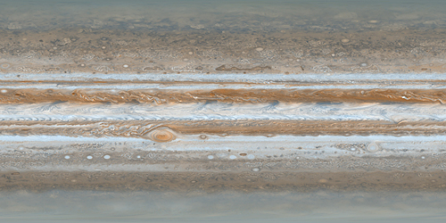
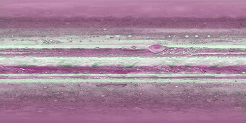
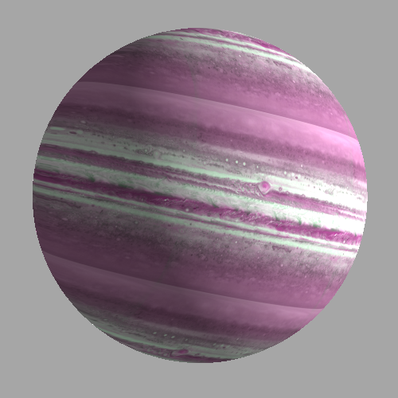
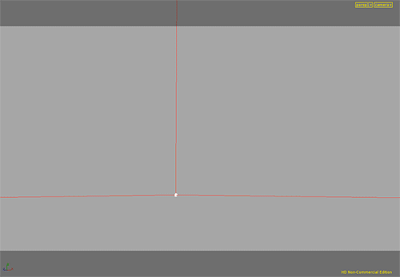

Something else I was very keen on from the beginning was texturing. If lighting was what gives a scene its atmosphere and conveys the feelings you want the audience to connect with, then textures are what make the subjects come to life. My scene looked very simplistic for most of the time while I was making everything and only put the textures on the week before I had finished and it made all the difference. I would have liked to do more complex texturing as during my search for tutorials I found out about displacement, bump and normal maps.

These would change the physical texture of some geometry only at render time causing light to react to the difference in hight and depth of the texture according to a special texture which is black and white or multiple colours. This will allow the regular texture look more detailed as the light reacted to it. This accompanied by properly applying the texture image to a texture map would have created realistic looking objects, using the Pelt SOP. However I couldn’t find anything which was up to date enough that showed this process fully so I applied my texturing using a Material SHOP which just laid the image over the geometry.

Here is an example of an image of sand which I duplicated 4 times in photoshop to get the colours on each edge to match as much as possible, however I didn’t really do much to make it blend allowing it to look seamless, I will probably watch some tutorials on how to do things like that next time.

Another aspect to texturing which I liked was finding very large images which would be seamlessly tiled. I didn’t have access to the highest quality resources as they were mostly for paying customers in various places. However there was an abundant amount of free resources which only needed slight Photoshop work to get them almost seamless. I think my sand texturing could have been more seamless as it shows obvious repeated patterns, but it was hard to see that in the small preview render and I didn’t want to spend hours rendering it out properly again.

This is something I would have gone back and changed if I had the time, and I can definitely see how rendering is very frustrating, having to make sure you know it will come out perfect as once it’s rendered the only thing you can do to fix it is to do it again. I didn’t spot it immediately as I had let it render while I was doing something else, if I had checked it sooner I could have cancelled it and then fixed the problem, like what had happened with my mountains and will be something that I’ll specifically put aside a lot more time for in the future.

I also used an Earth texture and Jupiter texture for the planets, but adjusted them slightly so they looked different, I reversed and rotated Earth so it wasn’t so obvious and looked more like a different Earth-like moon surrounding a pink gas giant which had the hue change and was also reversed. There was even a parameter to change the scale and reoccurrence of the texture over the sphere in the UV Project SOP which allowed it to look a lot crisper as if it was applied to the huge sphere as its current size, even though the resolution was relatively high, it would still have looked pixilated.

The process of texturing got me wondering textures are created for big film productions or very detailed stills that I see. It would be fascinating to know how much work goes into photographing things or making them from scratch, especially at such high resolutions they’d need. At the moment my texturing looks like something you would seen in a videogame, so it would be fascinating how to take that to the next level and learn how to do complex photorealistic texturing. Here is visualisation of how all the separate pieces of geometry come together to make up my scene:

After today, the day which the project should have been handed in, I finally get the feeling I’m making significant progress with my landscape. I now have it mostly how I want it and there are a few things I need to tweak. I will need to at some point get to the point where I’m happy to start rendering out the elements so they can be brought into Photoshop and given any final colour adjustments to create the effect I’m looking for.
