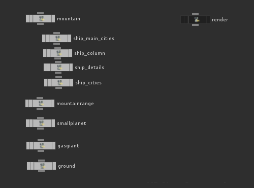
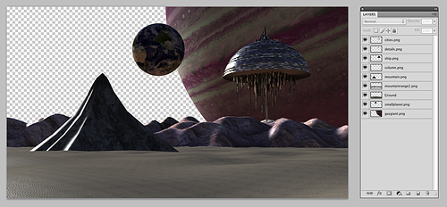
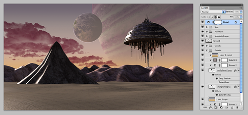
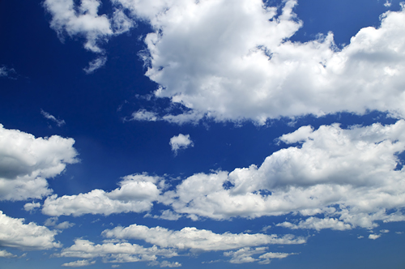
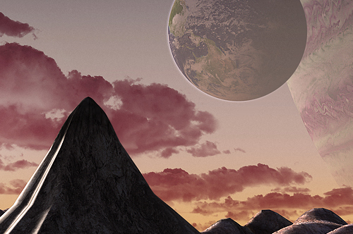
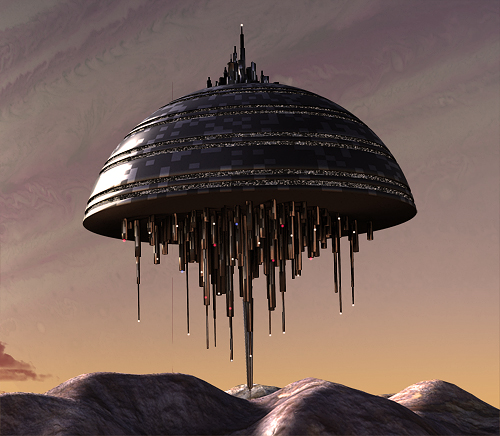

Rendering out my final scene was for a while what seemed to be the last step, but I soon realised it was only the penultimate one as I’d need to also set aside time for some post-production in Photoshop. This meant for the last week of production I had to work towards rendering out a lot sooner, at least one or two days sooner. This meant I had to step up my finalisation of the modelling and texturing and so on, which is probably why there a quite a few things about the final piece which I’m not particularly too pleased with and could have been improved on. Such as the texturing I mentioned previously and also the desert looks too plain with nothing really going on apart from some subtle hilliness.

I looked back on some of the work we had done as class exercises and in particular the one in which we looked at compositing in Houdini. I then made a separate Mantra for rendering out each piece individually, making sure to include the matte of an object if need to be in front of something. I deliberately didn’t matte anything that was to be placed in front of something as this would later allow me to make any slight adjustment to placement in Photoshop if I wanted the ship or planets to be moved.

After saving all of my separate elements as PNG files to keep their transparency and at a quad full HD resolution to keep the aspect ratio and to ensure I was above the 2000 pixel minimum. I then brought them into Photoshop using the script which loads a folder full of files into a layer stack of one document which would save time especially if you have many layers that need to be in exact alignment. I found this looking for a way which was more effective than manually shift + dragging each image into an open document which was inefficient and time consuming.

Once everything was together in Photoshop it was the first time I had seen everything together properly in a high resolution render. I felt rather proud of having created this scene from nothing but some 3D elements and some textures and relieved that it was finally coming together and wasn’t as bad as I feared it might turn out having never created anything using 3D software before. I felt that if I could make this, then I would love to continue learning so I can truly translate my imagination into something physical that can be seen.

I proceeded to think about how I was going to take these raw images and adjust them to bring out the atmosphere I had envisioned in my head. After sampling some colours for a sky from various photos of sky I acquired a base gradient to fill a layer with to fill the transparent gap which had nothing in it. I then duplicated this to place in front of the planets, then pulled down their transparency to create the effect of a hazy atmosphere which then washed the colours out of the planets slightly so the sky’s colours where more prominent. To get a sense of depth the layer in front of the gas giant had less transparency compared to the closer Earth-like moon so you can tell it’s further away.

I made sure to use totally non-destructive techniques such as layer masks so that at anytime I can go back into the document and adjust anything that I wasn’t happy with or if I wanted to change the atmospheric tone completely. This gave me a lot more freedom to experiment with different techniques to achieve the final look and feel of the image. I then went on to adding a little something to the area of sky which had nothing in it, it seemed too plain so I placed in a stock image of clouds and colour graded them so they didn’t look out of place, giving them a pink colour which you would see at sunset, always being aware of the placement of the sun, so the clouds were light from beneath.

I made a few other changes, things which I wanted to do in Houdini but was unable to get what I wanted. I originally wanted the inset part of the main hull of the ship to have hundreds of tiny windows randomly placed, however I took what I had learned from Pete and instead using it to create a difference in panel colour for the hull and decided to make the windows in Photoshop instead. I used the noise filter, changed the blend mode to screen and blurred a few duplicates creating an effect which looks like lights, and because I had thought ahead and done a separate render for only the insets and keeping a matte of the hull, it was easy to create a clipping mask so the windows only appeared in the insets where I wanted them to and also did this with some random light on the city-like structures.

Once I was happy with the overall image I then needed to save it, I changed it from 16 to 8 bit so I could have more options in saving and also so the file size wasn’t absolutely huge and saved as a small 1280 by 720 pixels preview JPEG so the image can be quickly opened and viewed and resized for my blog and anywhere else I’d like to put it and saved a full sized Photoshop document with everything intact so it was easy to see all the adjustments I had made in post-production.
