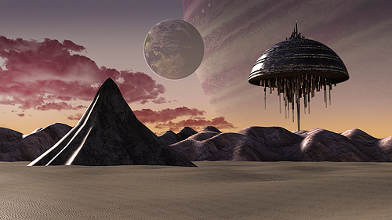
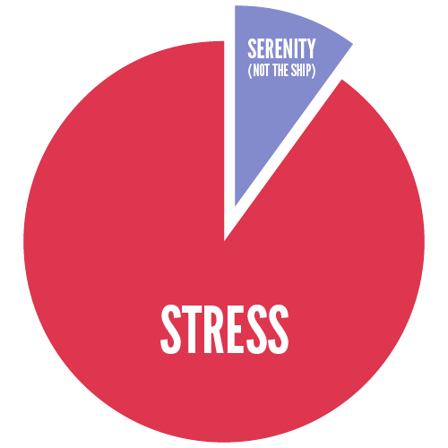

After many hours of trying to accomplish what I set out to do, I finally feel that I’m at the point where I can stop. It had taken many hours to render out each object and many many more hours to figure out how to do almost everything beyond what we had covered in class. Behold the final abstract landscape scene. Click for bigness.

Even though I consider it done, there are, as always, a few things I would either change, do differently or add. Some of which would be the shadow of the mountain that I forgot to add the phantom of it to the ground when rendering it, however it was too late once I’d remembered it. I will simply use it as a lesson to always remember things like that for later projects. Also I would have liked to include something, perhaps rock formations or boulders on the desserted floor. Additionally, I would have probably liked to make it more ‘abstract’ as I feel it does seem a bit too normal, especially the foreground objects, sans the ship. I think the parts I’m most pleased with are the ship and the way the planets turned out, especially now they have the haze covering them, faintly visible just like the moon on a cold winter’s eve.

Looking back on the past two weeks of which I had got most of my project done, I can say that the first week of starting was very stressful and filled with anxiety. It was one of the only times where I felt I knew nothing and couldn’t possibly make something which resembled what I wanted it to. Since the first week was still on the holiday I felt like I was a bit on my own without anyone to discuss technicalities with, and I wasn’t too keen on asking rather noob questions on forums. However, I did ask about why my Houdini wasn’t working as it should be since that was a very important thing I needed to resolve, it turned out to be an issue relating to OS X Lion compatibility, so after I put Snow Leopard back on my computer I could finally begin properly.

By now I only had a few days before the deadline and spent many hours every day and night going over as many tutorials as I could from the likes of [Peter Quint](http://vimeo.com/user2030228) and [3DBuzz](http://www.youtube.com/user/3DBuzz/) and a few other random tutorials I had found. This is probably where I felt the most stressed since learning material for Houdini is almost nonexistent. There are many very good tutorials. But they are either for extremely basic tasks we already covered or very complex professional procedures which were as much use to me as knowing how to do coronary artery bypass surgery on a Himalayan brown bear. After a few attempts at making the basic building blocks of my scene I had decided on things such as the composition and the lighting. Here is pie chart depicting the stress levels during the week before the deadline:

But then the deadline was delayed by a full week, which meant I could relax and think more thoroughly about what I wanted to do. Stress and relaxation levels returned to their normal pie slice sizes and I could slow down and make some decent progress on my scene.

The day we had a class after the holiday was very helpful, everyone was asking each other how to accomplish things and I learnt some stuff after asking a few fellow 3D classmates as well, which is something that only really happens in time of an impending deadline and should happen on a more regular basis. One of the most crucial things I found out was that you can simply copy and paste entire geometry from one Houdini file to another, rendering hours of watching tutorial about creating digital assets useless (until I need to know about making them of course) and learning the valuable lesson of asking someone something no matter how stupid it might initially seem.

After I found out how to get geometry from one file to another it made things a lot easier, I prefer making things in new Houdini files since mine got excruciatingly slow and heavy after I had a lot going on in it. It also meant I could experiment more freely without worrying about messing anything up such as my lighting and so on.

I think I have accomplished what I envision at the beginning of the term, and I especially couldn’t have done it without looking at vast amounts of art which really did inspire me in what I created. I would love to, in the future be able to express my imagination through 3D as I now see it is unparalleled in what you can accomplish besides writing a novel or being Leonardo da Vinci. Although I may want to look at learning other 3D programs later on that have much more documentation for them. It seems as though Houdini is more for complex animation and just feels a bit too powerful for what I want to use it for, like modelling.

I can certainly see how I could utilise 3D in many areas of what I want to do, if it’s working in film making CG for things that aren’t going to ruin the Star Wars films, help (cheating) with perspective for digital painting, bringing anything I imagine to life for fun, or combining 3D with photomanipulation or even graphic design. It will definitely be a crucial tool which I want to improve my skill and knowledge in and I look forward to extending my capabilities and creating some 3D art like what I see when I’m searching for something to inspire me.
