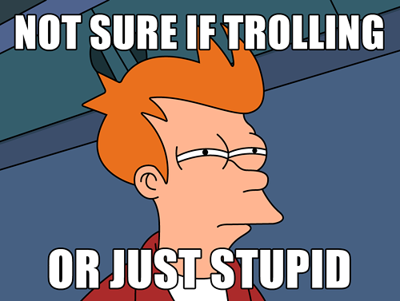

In protest of SOPA and PIPA and ACTA and any other legislation which wants to remove freedom to the internet I have turned to Fry for his wise reaction, also copyrighted material owned by News Corporation.

I have also created a blank vector version for anyone to customise and distribute in any mediums they wish to without any loss of quality so people can break copyright law in HD.

Download Fry in Glorious Vector Graphics
