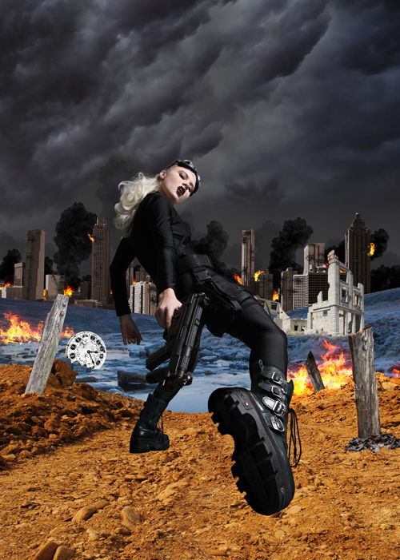
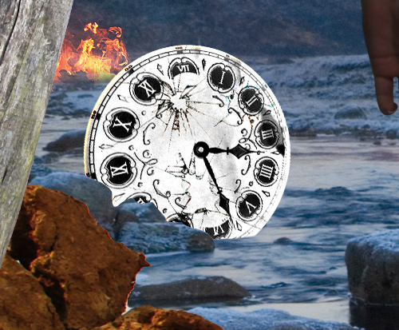

I have now begun thinking about exactly what specific stock images I want to use for my main piece. After trawling through websites such as [iStockPhoto](http://www.istockphoto.com/), [stock.xchng](http://www.sxc.hu/), [Fotolia](http://en.fotolia.com/), [CG Textures](http://www.cgtextures.com/) and the stock section of [deviantART](http://browse.deviantart.com/resources/) I had selected a number of photos and images I wanted to incorporate. I did end up changing a few thing around after roughly placing them in, scaling them and positioning them but after some tweaking I had a good base on which to start. Here is my second conceptual design of the composition, I have taken time to consider the scale of things and looked at a few other elements which I could include.

This wouldn’t have been anywhere near as quick as it would have been if I had not done my initial ‘sketch’ earlier on in the year where I threw down some stock to build up and idea of where I wanted to go and to get a visual representation of the composition. I even reused some pieces from that concept piece I did. As well as the websites I just mentioned, I also went through all the magazine websites for their free stock they often include with CDs which are freely available on their websites, and since this was a piece for personal and academic purposes I wasn’t breaking any of the agreements they included. This meant I could get hold of some stock from iStock and other premium websites for free, albeit not as high resolution as I’d have preferred. My stock hunting was also helped by the fact that iStock has a free file each month of so and I’ve collected a few over the years if anything looks like it would be useful.

Using these techniques I think I have successfully acquired as much high quality stock as I could for the least amount of money. I believe the most expensive thing was the sky at about £7 for a very high resolution photo of sky which I decided to use because all the free photos of dark clouds where very noisy and no where near big enough to be used for such a large portion of my image.

One of the main problems I had in the early stages of this process was rearranging the city. I had made it a smart object so I could easily resize it non-destructively, as I do with almost every element I place in the document, however this meant I couldn’t easily change the actually shape it. The city was situated behind the figure meaning you couldn’t see all the buildings which I had worked hard on getting them to look destroyed, using various layers and layer masks and painting in what was behind it. All this would have been lost if I took then entire group and rasterised it. However I decided that I’d have to do that and simply duplicate it, this wasn’t a problem but it meant that if I wanted to make any other changes to the city I’d have to redo the process of rasterising it, cutting it up and repositioning it.

**Required Stock**

Another issue I faced during the process of composing my scene was where will I place the required stock images and how will I use them? Early one even at the beginning of year I knew I was going to incorporate the grinding stone image and use elements from it in the foreground. I had already considered those in my head, and it was relatively quick getting those cut out and positioned to look like wooden stakes in the dirt as those they were part of an old fence or some other structure broken by the events depicted in the image.

I had no idea where I was going to even use as my other image for a while until quite recently. I looked at the images we had to use in other stock pack and visualised how I could use them or what I could extract from them. After some thinking I settled on the clock as I wanted to make the broken building look like a fallen clock tower, and have rubble leading up to the clock. So I went and adjusted the clock to look like that of a clock from a tower and added a smashed looking face to give it a glass look to it. I then added some finer details to it to give it some depth.

Additionally in this close up you can see the foreground dirt layer, which I didn’t use the pen tool on. I instead opted to use the same took which I used for cutting out the hair of the figure, after [following the tutorial we were shown in class](http://youtu.be/vUIcQ1nXkWk) I decided it might be more efficient to use the refine edge tool found in CS5 as it was far too complex to use the pen tool and I would have been there for a very long time. I will make a note of it’s edge for later on and clean it up a bit so it doesn’t look too jagged. Overall I don’t think the acquisition of stock was as difficult as I first thought. I had initially thought I’d be searching for the the right stock for ages but thankfully I had searched for it way ahead of time before I even began properly putting my piece together.

**Stock used:**

[Figure](http://mjranum-stock.deviantart.com/art/Say-Cheeze-3-192588724)  
[Stakes](http://pixellyperfectstock.deviantart.com/art/Nose-to-the-Grindstone-192889254)  
[Clock Face](http://o0-pyromancer-0o.deviantart.com/art/Retro-alarm-clock-04-86538659)  
[Dirt Road](http://www.sxc.hu/photo/1351802)  
[Ben Wyvis](http://www.istockphoto.com/stock-photo-6508876-ben-wyvis-at-sunset.php)  
[City](http://www.istockphoto.com/stock-photo-5489812-downtown-atlanta-ga.php)  
[Ruins](http://www.photoshopdaily.co.uk/freebies/building-pack-2/)  
[Clouds](http://en.fotolia.com/id/22624609)  
[Smoke Brush](http://browse.deviantart.com/resources/applications/?q=smoke%20brush#/d1b9daq)  
[Water Ripples](http://browse.deviantart.com/resources/stockart/?qh=&section=&q=ripples#/d2s8nzw)  
[Fires](http://www.cgtextures.com/)  
[Smashed Glass](http://www.cgtextures.com/)
