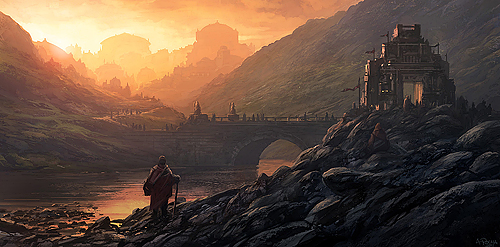
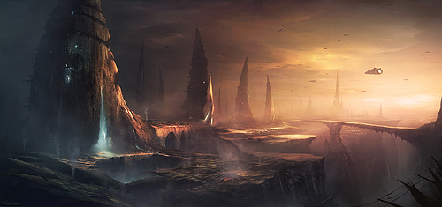
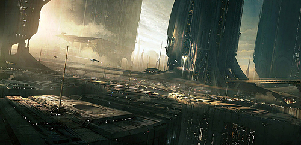
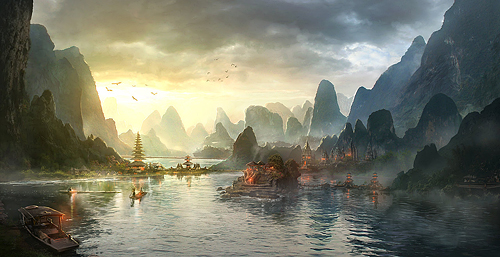
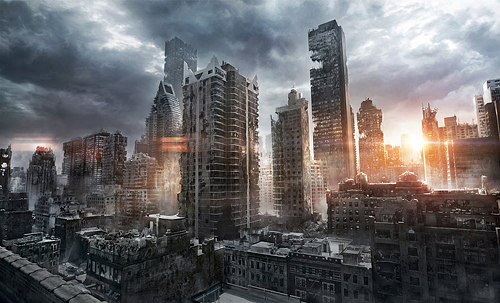
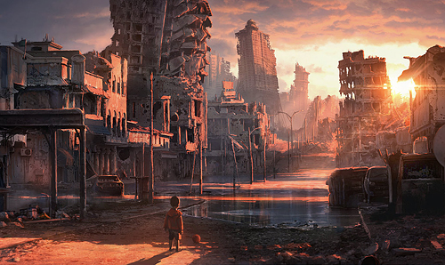

In order to get a better idea of how to incorporate an element of depth to my scene I’ve been looking at a few examples which I think handle it really well. There is a clear hierarchy of the elements in the foreground leading back far into the background there the colours become less saturated and lighter. The contrast is reduced and the colour of the atmosphere blocking the path emanating and reflecting from objects and scenery in the distance, something I need to achieve for my scene to look real. Here are a few examples from I looked at:

I have also been looking at destroyed buildings and skyscrapers. I want to add gauges in the sides of the buildings to make it look like they’ve been hit with artillery or some other kind of weapons to show there is some kind of conflict happening within my scene. Here again are a few pieces I looked at to see how other artists have covered this aspect.

I’d ideally like to paint this in, however I feel I won’t have enough time to develop a good technique to cover the area I want to efficiently and effectively. I was think of perhaps creating a duplicate of the city and having the layer underneath as what the buildings might look like with their windows and walls missing and simply use a layer mask and a brush to take away areas where I want them to look destroyed.
