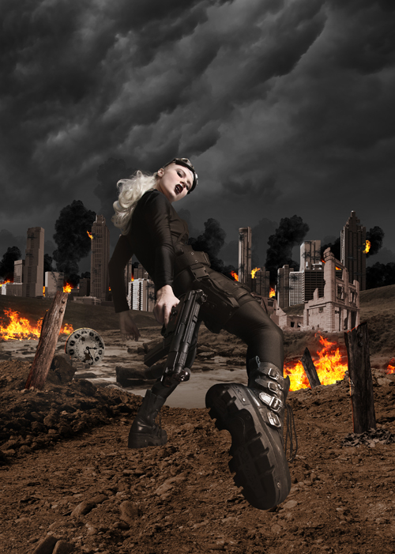
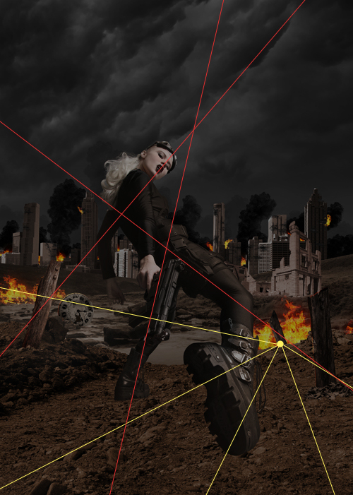

After assembling my piece to the point where I’m happy to continue I then was tasked with having to colour grade everything so it matched. Using all the non-destructive techniques I had learned at the beginning of the year I went through every layer making sure everything had the right lighting I wanted it to and any colour corrections. This ensured everything looked as though it was supposed to exist within the same environment as everything else.

This is also one of the best parts as it’s where I can see it slowly coming together to form a full image instead of a pile of images placed on top of each other. This is also where I began adding details and starting thinking about the lighting. At the moment the image looks a bit flat and unnatural, I asked a few people what they thought about it so far at this stage so I could get some unbiased views on what needs changing or improved on.

I wanted to see if there was anything particularly wrong with it in terms of perspective or the way the scene was composed from someone else who didn’t have any bias of haven actually made it and been exposed to it for so long before I went any further. The advice was mostly in terms of lighting and how that can dramatically improve the realism of the scene which is what I will do next.

Also, here for illustrative purposes I have used red lines to indicate where there are sweeping straight lines within the image which are psychologically pleasing aesthetically. This should hopefully mean my work would be something that people will be drawn towards as opposed to be repelled by awkward placement, which is something I participially have tried hard to to do. This is also one of the reasons why I chose the clouds that I did as they formed this strange diagonal line and when placed correctly this then aligned directly with the figure’s head and then down through the arms.

Another aspect I’m trying to be conscious about now is the lighting, I have looked at the path the light will be taking as it leaves the main source in the foreground from the fire behind the ridge. I have, again, indicated the trajectory of the shadows in yellow which should make it easier for me later to align everything up so it resembles how light and shadows should behave in the real world.
