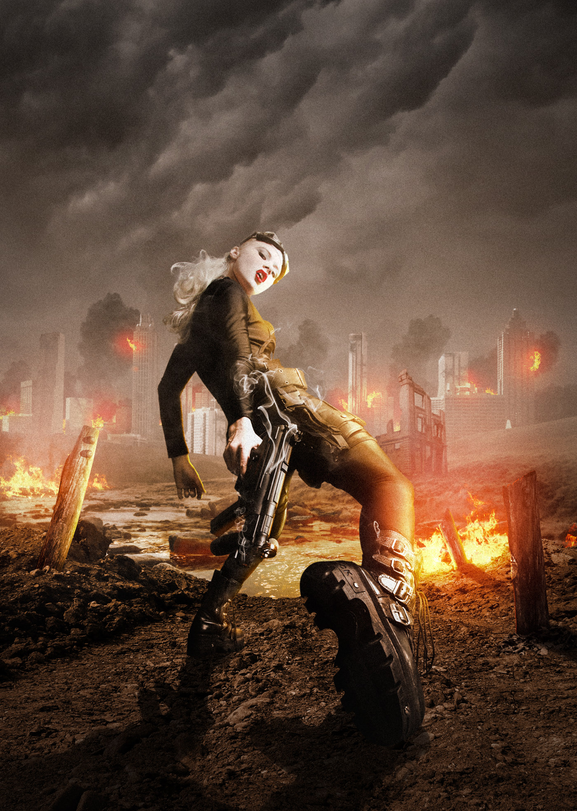
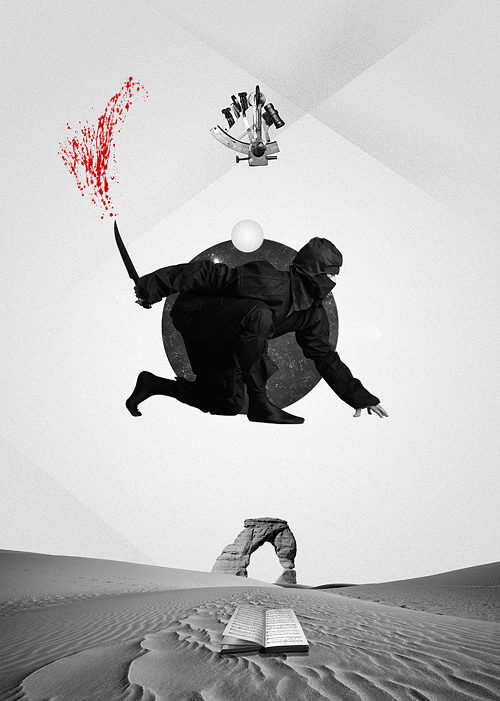

**First Piece**

After a few hours of carrying out final refinements and adding in details and applying all the lighting to make my piece look dynamic I have finally decided to stop. I could have easily carried on even longer adding elements and changing things however I thought it was time to stop otherwise I wouldn’t have had time to do the other piece.

There are a few things now after looking at it finished that if I would go back and continue I would change. For instance, I was unable to make the clock look as though it was part of a fallen tower, this would have required too much time for something which will mostly be hidden by the figure so I decided to abandon that idea. I would have also liked to do something more with the ruins in the foreground as they seem a bit forgotten, I could have added fire or smoke or charred areas to parts of the building to give it more detailing and a sense of belonging.

Overall I’m very pleased with the outcome, a few things may have changed along the way but I feel that it is as close to what I had envisioned at the beginning of the year as I think I could get with the skill and technical level I’m at right now. Perhaps I could have looked at the shadows a bit more and they seem a bit awkward as though they aren’t behaving quite as they should, and I would have gone back and done some digital painting to bring out more details in the destroyed city.

One of the very last things I did was add in the dynamic lighting onto everything and to give the scene a sense of depth by giving things in the background a less saturated and lighter feel to them. This is something which I’m new to as I’ve never had to think about depth of field and lighting so much in terms of creating something from scratch. I will certainly take these skills I learnt and be able to expand on them and utilise them in future projects, such as digital painting which I very much want to get into.

Another part of the image I was trying to be aware of was the space at the top. For a while I thought it could be used for a large title, as though it was a film poster or something much like what I had looked at before when I was first looking at something to give me inspiration. I feel that this is something I could have explored or experimented with more in detail, perhaps creating a fake film name in some dramatic Hollywood fil poster style typography to take that idea a step further.

**Second Piece**

One of my biggest downfalls in this assignment though I think is my second piece which I didn’t give much thought to until the very end. This was mainly due to having such a definite idea so early on for my first piece which I then worked on and developed throughout the past few months, assuming I would eventually come up with an idea for the other piece. This didn’t transpire though and I ended up on the night before the deadline struggling to come up with a theme for it. I had thought about what I could do for a while however, the real difficulty came with choosing the actual stock which was required. I simply couldn’t come up with a combination which I felt I could do something good with.

I originally thought of doing an abstract piece which I could then not have to think about any particular coherent composition for, and simply had to convey an idea so that is what I settled for. I hastily went through my deviantART favourites for some inspiration and begun working on my second piece. This defiantly taught my a valuable lesson, which is to no assume I’d eventually come up with and idea and keep putting it off until it was almost too late. I had become carried away with my main piece which I wanted to put all my effort into and neglecting the second one.

I am not particularly happy with my second piece at all. As a thumbnail, yes, it looks okay. But as soon as you look at the full thing it has no apparent structure and is far too ambiguous to carry an idea or concept, nor is it engaging or crafted well enough to be a stand alone piece of abstract art. As a result it looks exactly what it is, a rushed attempt at abstract. Something this taught me more than anything (besides ‘don’t leave something so big until a few days before the deadline’) was how to come up with and idea, look at my inspiration collections, find stock, do careful background removal on all of my elements and assemble the final piece all within a few hours. Perhaps something like that will be useful for smaller scale projects, but for this assignment I don’t think it turned out very well at all.

I believe the culmination of this project has yielded two interesting outcomes, one; a piece I am very happy with and feel that the considerable amount of time spent on it shows, learning a great deal of techniques along the way; and the other, a hastily assembled piece which didn’t meet my expectations, but gave me an insight into beginning a project and finishing it within a very small window of time. I can safely say I learnt a lot which I can apply to future projects and instances where I can utilise these skills.
