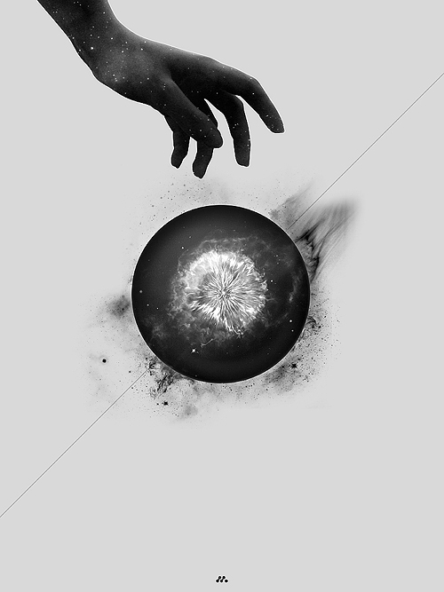
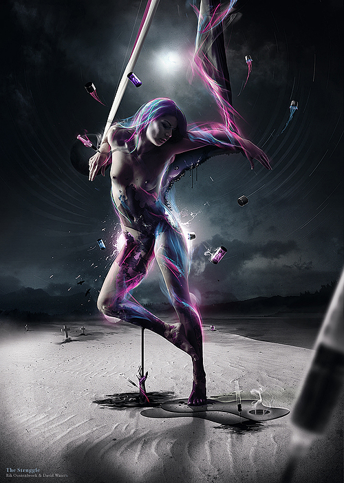
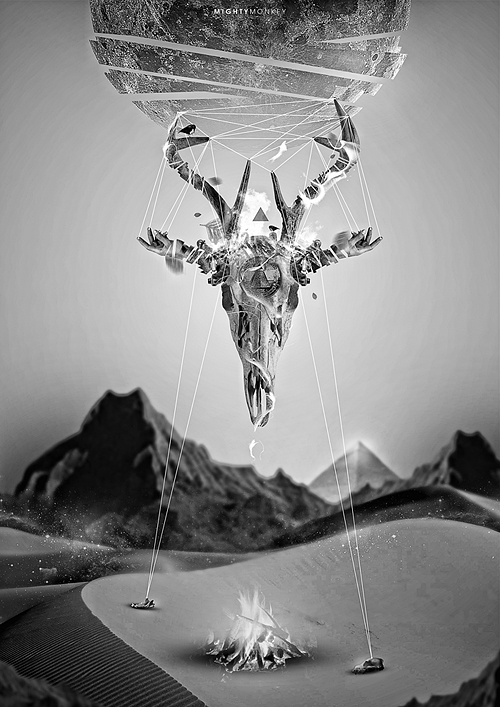
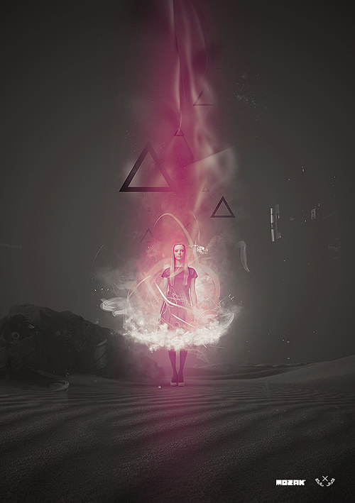
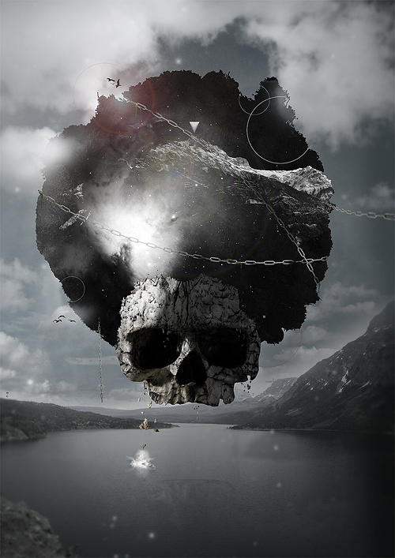
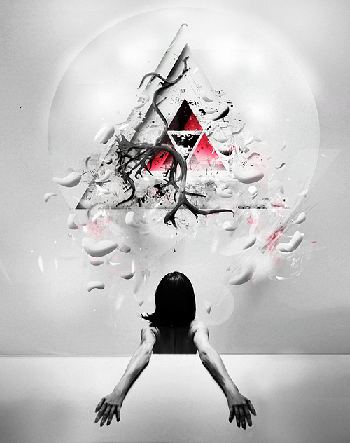

I didn’t start my second piece until very late so I didn’t have much time to think of and idea. I had to look at a lot of work to give me some inspiration and ideas of where to go in a short space of time. I turned to my deviantART favourites collection and scanned through all of them until one type of artwork caught my eye. I knew I wanted to do something abstract so I started looking at that kind of work was where I wanted to start looking and from there I noticed a trend in what I liked and begun looking at similar pieces. Here are a few examples:

I really liked the design which carried on throughout these pieces. The often black and white designs concentrated at a central point in on the page with something at the bottom grounding the piece and usually giving it some juxtaposition. I wanted to emulate something like that in my work and bring across similar ideas in what I wanted and the feel I am trying to convey.
