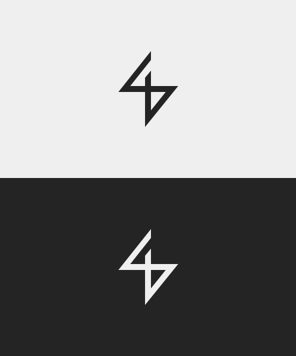

On one occasion I arbitrarily decided to create a logo I had been going over the design of in my head for a while which represented the number 44. It depicts one type of four with the other way of writing a four upside down and merged into each other creating a dynamic design which I had been sketching while bored in class. Here is the finished logo showing the two contrasting versions so get a sense of how it would look:

I feel the logo works quite well in different sizes and is easily distinguishable even when it’s a tiny thumbnail icon which is an important aspect to logo design. The only problem though is the logo doesn’t belong to anything or anywhere. Perhaps I can fabricate a hypothetical company to give it a home.
