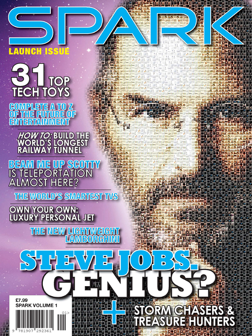
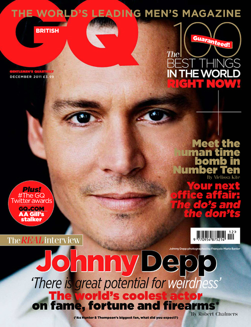
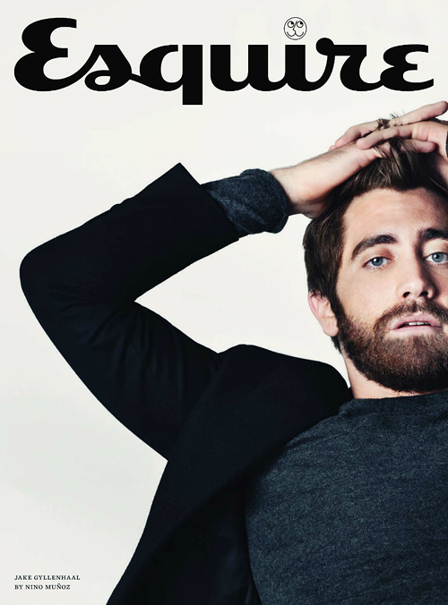
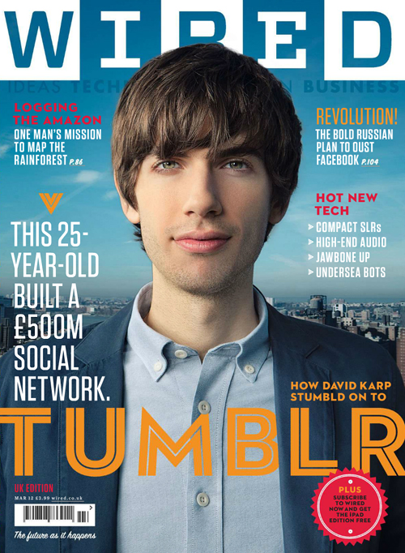
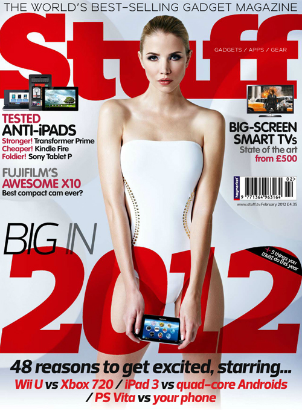
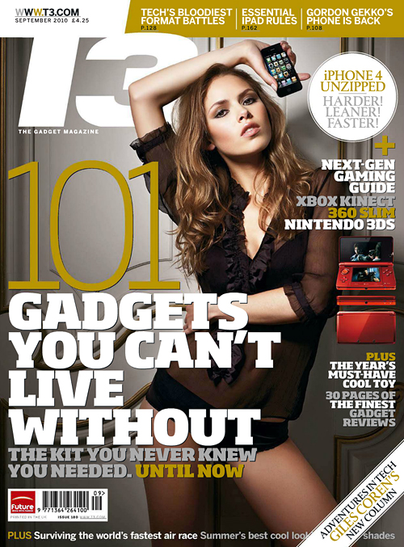

After looking at the brief and feeling that it seemed like an interesting task which appeared to have an actual purpose, as opposed to the previous typographic assignment that was very cryptic.

I went to the shop and searched through a lot of magazines, trying to pick out candidates for the assignment. It took a long time to meet the criteria set ion the brief, not only that, but I wanted the magazine to cover something I was actually interested in. I saw a lot of magazines that very problematic, but they were usually about something I didn’t know anything about therefore I was not in the position to judge whether or not it was in fact problematic for its intended audience.

Many magazines looked like they were designed poorly, however if the design was dramatically changed that would require the magazines target audience to completely change as well, which didn’t seem very realistic, nor would give enough creative constraint that it would be worth while. I wanted something which I could keep within the magazine’s existing boundaries, but needed to be focused or steered in a slightly different direction.

I considered doing a low brow women’s magazine, and saying in the my brief that said magazine was not doing well in its current market, and wanted to reinvent itself, turning it into a magazine of much higher standards, however I felt I might as well design my own magazine from scratch if I was going to make so many changes. The design prospects that would have provided would have been interesting to explore, but I would not have known anything about the content’s subject matter, entirely ruling out that idea.

I continued to purchase a few good candidates of which I would do some further analysis of when I got home. I bought Digital Artist for it’s very complex and overwhelming layout which would distract from the art it features, the official Windows magazine because the new Windows 8 operating system will be released this year and has a distinctive style which can be translated into print, and also a newly launched magazine called Spark. This magazine stood out to me as the best candidate as the content was technology and science based and the design didn’t complement the type of magazine it was or where it was being placed on shelves.

I noticed immediately that the cover’s design has many aspects which are features of bad design and where very prominent. Some of the more notable instances of bad design include the use of outlined type with an obvious drop shadow, a confusing layout with no evident grid system holding anything together making the elements look randomly placed, multiple fonts which don’t compliment each other and a poorly made cover image incorporating the Mac OS X Snow Leopard default desktop image with a collage making up Steve Job’s iconic Time Magazine photograph with an unsightly glow effect highlighting the edges.

The design faux pas didn’t end at the cover. They continued throughout the entire magazine. However the beginning of the magazine isn’t as bad as the rest, the layout is consistent as well as the colour scheme and fonts, but as you get further into the editorial you begin to see that almost every article features a different and often badly designed font. There are also elements which look like they are more at home in web design such as transparent boxes with type, arbitrarily places text in unnecessary places, and poorly chosen images, usually at a resolution not suitable for print.

Overall it looks as though this magazine is a prime example of something that needs redesigning. The magazine was placed with other magazines such as GQ and Esquire, indicating its target market of general male interest. The magazine would probably be more suited to be compared to magazines such as Wired and T3 due to a strong technology and popular science theme. The problem is only with the design, the content of the editorial covers very interesting subjects, which myself would be drawn to, if it wasn’t for the initial poor design of the magazine compared to it’s counterparts on the shelf. Here are a few examples of what it is up against:

In my brief I could explain that the magazine hasn’t been doing to well with its clearly intended audience and needs to be redesigned to fit in with a more design conscious audience if it is to be placed with other magazines which appear very contemporary and refined. Additionally, the magazine is also relatively new to the market evident from there only being two issues so far and the price also does not reflect the nature of the magazine. It lacks adverts and therefore the consumer is paying for the full price of the magazine, this gives the publishers even more of a reason to make the magazine as attractive as possible to do well in a market filled with rather sleek looking magazines.
