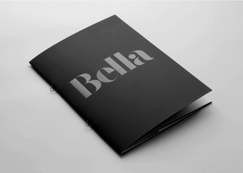
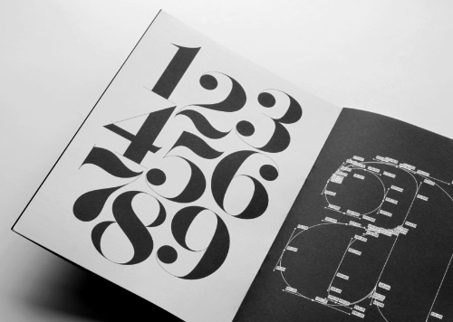
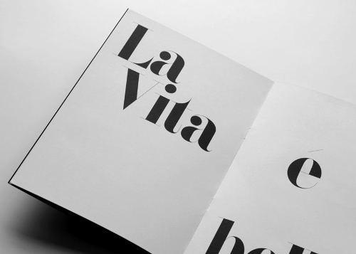
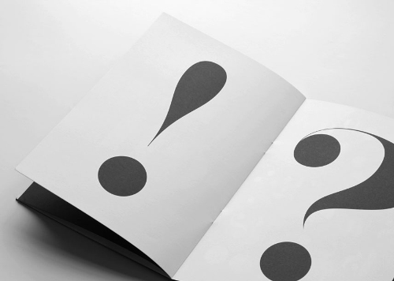
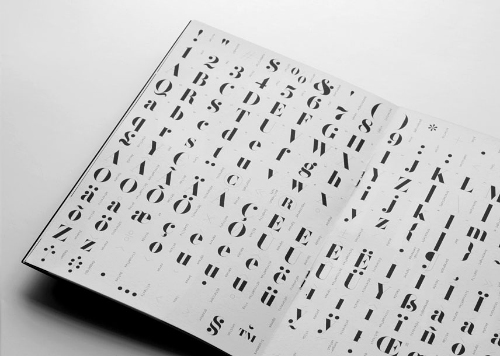
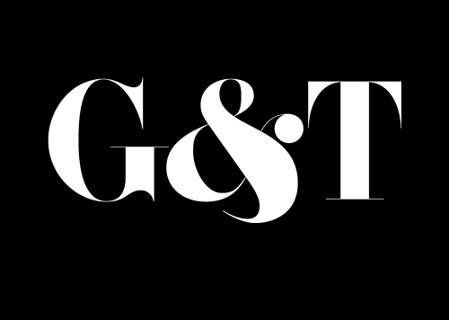

I decided to look at a typeface that I have wanted to use for a long time, F37 Bella, designed by [Rick Banks](http://www.face37.com/) of the Face37 foundry, and see if it would fit with the magazine I chose. Here are some examples of it in use:

It clearly is based on the Didot style but uses contemporary geometric forms to stand out from other typefaces which take similar design cues. Another feature of it which I like are the extremely thin hair lines, making it only really useable at larges sizes. According to the designer it is ‘based on letterforms of American typographers; John Pistilli and Herb Lubalin, and Swiss typographer Jan Tschichold’, I will look at these typographers for further research.

After looking at the typeface in detail and trying to imagine its use in my magazine, I can’t see it fitting in, it is a very grand yet delicate typeface which would suit a different situation very well, but alas I still do not have a chance to use it within my design. Additionally, it gives a sense of femininity which wouldn’t fit well with the magazine’s male oriented subject matter. It simply doesn’t convey the relevant language of the magazine through it’s design. I will have look continue my quest for a typeface to use.
