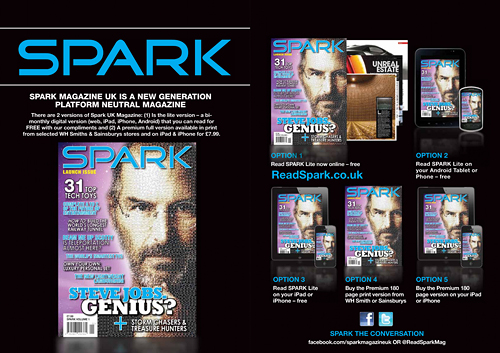
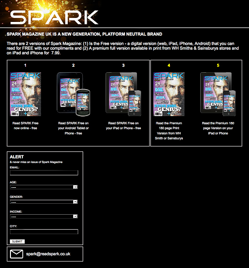
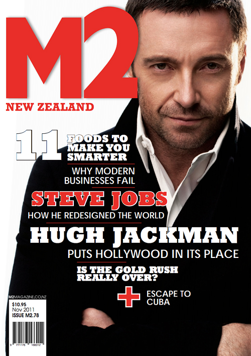

In order to get a better understanding of the magazine I’m going to redesign, I have been looking at the magazine itself, their website and used their iOS app, which they heavily promote in the magazine. I will also take a brief look at the company behind the magazine to get a better sense of what direction they are trying to steer it.

The magazine is contains editorial covering subjects such science, fashion, technology, and even film. The magazine seems to take a very general approach to what it covers, pretty much ‘stuff that males find interesting’, as it was located with other men’s magazines and contains photos of Michael Fassbender wearing Hugo Boss suits and a few pages of watches which seem to dominate men’s magazines such as GQ. Later on in the development stages, I will look at a few other successful magazines to see if I can learn anything from how they handle things.

The first place I looked was the magazine, on the first few pages we see a message saying briefly what the magazine is: “Spark Magazine UK is a new generation platform neutral magazine”, it then goes on to explain the different methods of consuming the magazine, such as a digital version on their website, app versions and the premium print version of the magazine. I have taken a look at all versions of the magazine and they are exactly the same. There is no difference at all between the digital versions and the print version. This is one of the biggest flaws so far.

I feel that it fails in both areas, the print version takes on too many digital aspects which don’t work in print at all, such as over use of low resolution images, transparency, large text, and bad composition. However this still doesn’t work as a digital magazine when looking at the iOS app or web version as it is too much like a print magazine still to function well on small devices or in a browser. This gives me a good opportunity where I can explore why the print version fails due to incorporating a digital mindset and showing why the two need to be completely separate and follow the conventions which allow them to work well in their respective formats.

I subsequently went to look at the magazine’s website and look at their apps. The website was rather surprising as it offered no more information than the first page of the magazine did. The online version was also very buggy, did not work well as a digital magazine at all and crashed my browser frequently. The app was equally abysmal, frequently crashing, no interactivity, no difference from the print version, essentially a PDF which you couldn’t even zoom in on to read anything. Not a good start for a magazine which prides itself on being cross platform. The magazine itself seems to be genuinely doomed if the quality of what they produce continues at this level, making it a good example of something in need of a redesign.

Yes, this is the entire website

I can include this in my brief, and say that the newly launched magazine is not doing very well due to all of these problems. This will give me a good basis in which to start my design, looking at what it’s trying to be and say what it needs to do to achieve that. Also in my research I looked at the parent company behind Spark, M2network, a company based in New Zealand and Australia. They produce the two magazines, M2, a men’s magazine which looks familiar to GQ, and a women’s magazine called M2woman.

This is interesting because it shows me the type of magazines this company publish and I can instantly see these magazines suffer from the same design choices, meaning that Spark has clearly taken the design from these magazines. The M2 website looks equally as bad as the Spark website, but has a lot more information on it, although not much about the magazine itself. I did however find this piece of text describing Spark Magazine:

From space travel, to Energy generation, to new types of combat suits, technology in all of its many forms is the ever evolving, Spark Magazine is an inspiring collection of the latest and greatest innovation that mankind is capable of producing.

It seems strange that I would need to go to all that trouble to find a substantial description of the magazine. Another example of how they do not have their priorities in the right places. From this I get a better sense of what Spark Magazine is trying to do. This will help me in determining how the aesthetics will evolve for the redesign and I will try and convey this message, which is so far missing from the magazine and any advertising material.

Overall I feel like I know a lot more about the magazine and can now start coming up with ideas on where I can take the design such as a colour palette, the typography and the layout so that I can effectively translate the objectives of what the magazine is trying to achieve through the content it is providing.
