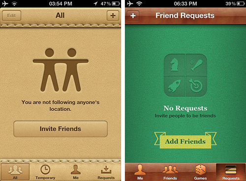
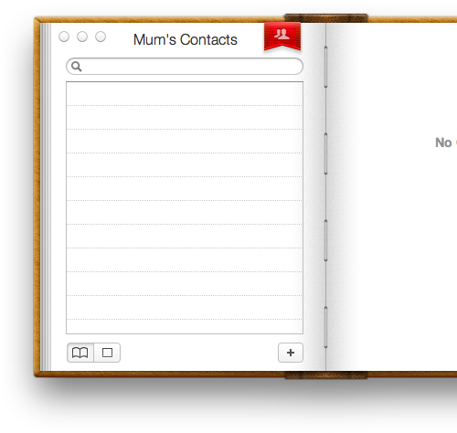
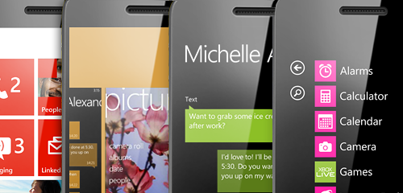

After looking at web interface design the other week, I decided to start looking at different interfaces around me and deconstructing them to make sense of the design choices the creators might have be considering while developing them.

One of the first places I looked was Apple’s iOS and the more recent releases of OS X. Lately I have noticed their software has been dominated by gimmicky faux wood panelling, low-res JPEG artefact covered cork textures and bright honey leather safety boot finishes with garishly detailed imitation stitching, which prompted me to question why Apple, a company synonymous with design, have been producing some rather ghastly looking interface designs.

iCal in Lion

Find Friends & Game Center apps for iOS

Inspiration for Apple’s software design team

This reminded me of a [review of Lion](http://gizmodo.com/5819418/mac-os-x-lion-this-is-not-the-future-we-were-hoping-for) from a while back on [Gizmodo](http://gizmodo.com/) which outlines the recent use of the metaphors for real-world objects:

> Why is Apple reproducing things that are obsolete already? Do people still use calendars made of leather and paper? Do people use agendas? Seriously, does anyone under 18 even know what these are?

This caused me to ask myself if this kind of design of replicating the look and feel of of real-world objects and making things feel familiar is relevant now or even something that will last into the future as people move on from using physical things to the usage of digital applications which do the same job.

This idea comes from the apparent inclusion in the iOS guidelines for the emulation of tactile surfaces to encourage touch in the design of the interfaces. However that may have been relevant back in 2007 when the iPhone was released and touch screens were relatively rare, but instead of toning this idea down as the concept of touching screens has become completely normal, they are making it more abundant and obvious than ever before.

I then ask myself, where does mobile interface design salvation come from? Microsoft of all places, with Metro. Metro has a very fluid, fresh, minimal look and feel to it which I personally prefer and is a lot more aesthetically appealing than the interfaces of iOS or any of the Android designs which use a similar button/icon on solid surface design.

When I look at the different aspects of the interface I get a sense that they are made of plastic and are set into a solid surface, unable to move which begins to feel claustrophobic after a while. However the design of Metro is typographic centric, sharp and there aren’t digital metaphors for ‘surfaces’ as the type flows and slides around the screen as though it is floating infront of either solid colours or images giving a sense of depth.

It seems as though the Metro interface belongs more with the perfectly minimal industrial design of Apple’s products than iOS or Mac OS X belongs on them. Which I feel is backed up by many people including the [review of Lion](http://gizmodo.com/5819418/mac-os-x-lion-this-is-not-the-future-we-were-hoping-for) from Gizmodo:

> Perhaps the Apple software people should have taken a page from Jonathan Ive and his cronies: Simplify the interface, get rid of the things that don’t add any information to the user, all the useless adornments.

The feelings I get from the design of an interface is particularly important to me since I would need to enact with it for substantial portion of my day and I think that those feelings it conveys can affect how you feel to a certain degree. Where Metro feels weightless and minimal, iOS is feel weighed down in textures which after a while become overwhelming and give me a sense of being locked down and restricted, probably a by product of the very nature of iOS itself.

I believe the way I react to the interfaces I use on a daily basis affects the design ethics I possess and develop as they influence the subconscious feelings I get from using them and how others may perceive designs of my own creation. Interface design is certainly an area I’d like to expand my experience in, whether it’s for the web or for applications.

**Update**

I will finish with a quote which I think explains how I feel about user interface design, whether it’s for software or the web, it should carry over to many different applications and areas:

> \[Apple's fragmentation of using real-world metaphors in their new UI\] is the antithesis of Jon Ive’s minimalistic design, all essence devoid of artifice. In fact, it goes against everything Apple used to defend when it was king of user interface development: that everything should follow the same language in order to make everything intuitive and familiar to the user.

[Jesus Diaz on Mountain Lion](http://gizmodo.com/5888597/mountain-lion-review-what-happened-to-apples-innovation)
