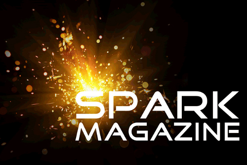
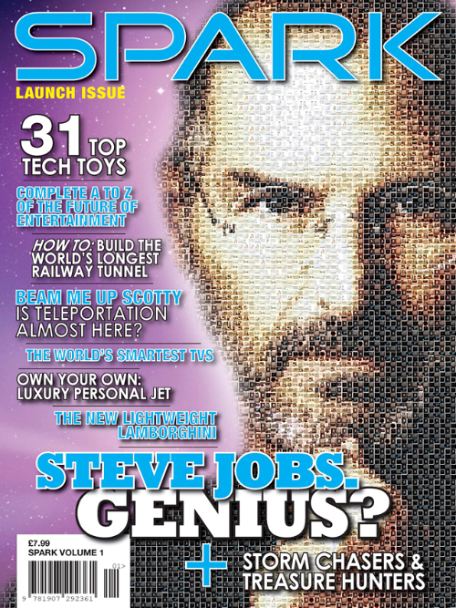
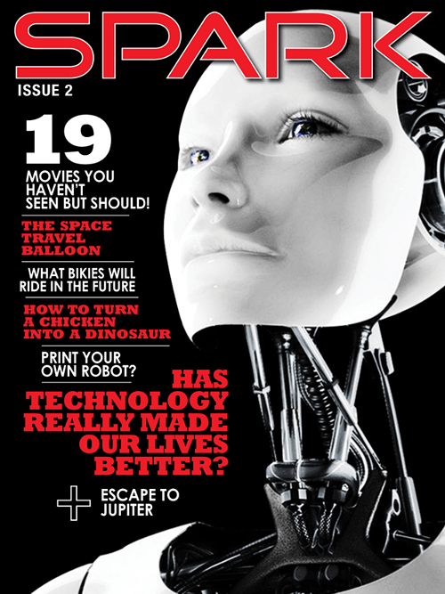
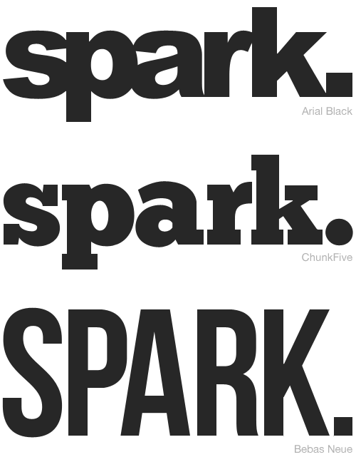

Before I wanted to go too far into redesigning the magazine, I first wanted to start at with the typography. For me this is the wall which stands between the very beginning and the rest of the entire production of the magazine. The typography will be the thing which gives the magazine its look and feel from the typeface of the magazine’s name to the body copy which makes up the bulk of the magazine.

I wanted to pay particular attention to the typeface used for the name of the magazine first as I feel this will then filter down to the headings and the body, determining the nature of how the magazine will be perceived by its audience. The Title’s typeface will provide the magazine its character, portraying initially how the magazine should be seen, and then the headings would need to compliment the overall feel of the magazine, and then the body copy will need to compliment all of these feelings and ideas tying it all together into something which is consistent.

I didn’t want the entire embodiment of the magazine to be an after thought so I began with looking at the name of the magazine to get a sense of where I can go with the design. The magazine is called Spark. An interesting and dynamic word that can mean a number of things to many people. The current incarnation of the magazine’s name is bland, it takes a tacky futuristic typeface and in digital instances adds a stock photo of sparks to accompany the name like so:

However, in print, this concept is completely lost. It would be impossible to incorporate and image into a logo, let alone the title of a magazine, it wouldn’t work with the background images or print very well in different sizes. The concept of using imagery of sparks along with the work spark is, in my personal opinion, very dull and obvious. It feels as though no real thought went into in other than simple work association which ultimately comes across as being a half-hearted attempt at making the magazine stand out. Here is what the logo looks like in print, on it’s own it doesn’t appear to have any meaning besides ‘here is a dynamic word in a cool looking font’ which is something I want to avoid:

Looking at synonyms of the word spark gave me an idea of where to take the concept of the design with this extract from the Thesaurus:

> verb  
> *the trial sparked a furious debate*: CAUSE, give rise to, lead to, occasion, bring about, start, initiate, precipitate, prompt, trigger (off), provoke, stimulate, stir up.

This lead to me thinking of someone or something ‘sparking’ or causing a debate about a particular subject, which is what magazines tend to do in that they cause a dialogue between the reader where the person is digesting the information given to them by the writers of the articles, and then thinking about what the articles said, backed up by this extract from the Thesaurus:

> verb  
> **1** *they will debate the future of rail transport*: DISCUSS, talk over/through, talk about, thrash out, hash out, argue, dispute; informal kick around, bat around.
> 
> **2** *he debated whether to call her*: CONSIDER, think over/about, chew over, mull over, ponder, revolve, deliberate, contemplate, muse, meditate; formal cogitate.

I found this to be a much more interesting direction to take compared to using the standard idea of a spark being a flash or flicker of light. The idea of the magazine sparking an interest or provoke thought on subject matter feels like slightly deeper in terms of meaning, showing the magazine has depth to in, evident in the types of articles, ranging from topics on science, space, technology to notable people, fashion, and architecture. The magazine is clearly in the ranges of Wired magazine, another magazine which looks at these subjects.

I went on to consider how someone who would spark a debate or provoke something would be a bold person or have bold qualities which lead me to think about the name being big and bold and to the point. I then started to explore different ways of composing the letters and the type of fonts which could be used. Here are a few early examples:

I decided early on to give the title a full stop as this makes the word feel punctual and assertive, bringing me back to synonyms of the word ‘spark’ in terms of causing something such as prompt, trigger, provoke, stimulate, stir up etc. All these felt like suitable words for the type of feelings or language of the design I wanted to convey. And I experimented with the kerning to condense the word as much as possible to make it look like one entity instead of individual letters, making it look strong. I would need to develop this further through various design elements so that it is apparent that this is how the magazine should be conveyed by the audience.
