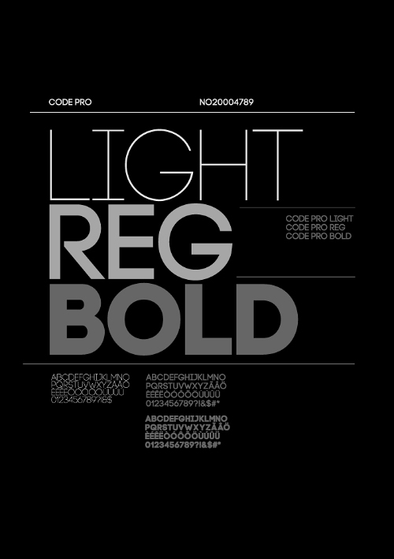
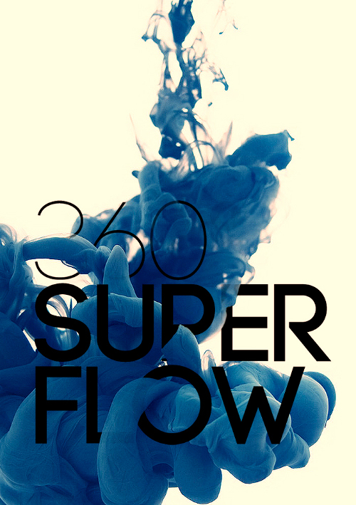

After looking around at many different fonts I think I have finally decided on a font for the logo. I will use the typeface [Code Pro](http://fontfabric.com/code-pro/), from [Fontfabric](http://fontfabric.com/). I feel it is a good choice as its geometric, but has some character to it and conveys the language of technology quite well. One of the best things about this typeface are the fact it is and entire font family with many different weights while still being relatively inexpensive. This means I can utilise these for things such as headings and titles within the magazine itself and the it will all compliment the logo. Here are some examples of it:

Code Pro is said to be inspired by the “original Sans Serif fonts like Avant Garde or Futura … it is clean, elegant and straight-to-the-point”, I like the fact it still retains strong features and has an impact, especially when in thicker weights. The thin weights would also be useful as they can add some variation to the typography within the magazine, such as article titles or headings. I will experiment with some logo variations for my magazine redesign and see what the results are like.
