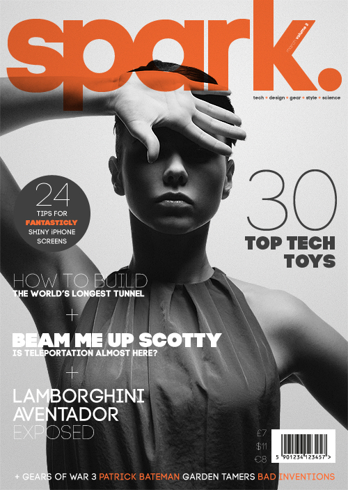
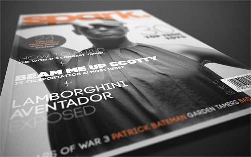

Lately I’ve been doing some experiments with cover layout. I wanted to get a feel of how the magazine would look, and how I can incorporate the different font weights from the Code Pro typeface family. I also found a large stock image as a place holder so I had something to work with while I looked at ways of displaying information on the cover without it getting crowded or losing the sense of structure like the current Spark cover does.

I used the logo on it’s own without the circle to see how it would react with a multiply blend mode over the image to see if this idea would be worth pursuing, however it is proving difficult to get perfect results with blend modes in InDesign. I’ll have to do some research into that if I’m going to develop that further.

I also began thinking about the theme for the magazine’s cover images. I liked the way the orange (or any other colour) looks against a muted black and white photo. I then considered what the covers could be like as the issues come out throughout the year. Little White Lies has a very distinct cover theme, they always use illustrated images of someone from the notable film.

The newly redesigned Spark magazine could have a theme of its own, it could be that each issue has a black and white portrait of someone featured in the cover story. This is something I’ll think about the logistics of as I would not have easy access to images, but its something to consider as it would affect how the content will appear on the cover in terms of the layout and any grid that I produce for it.
