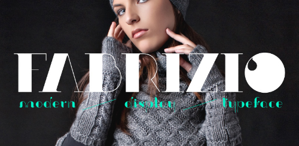
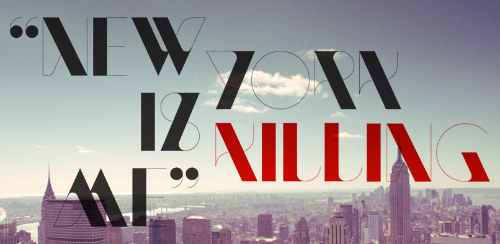
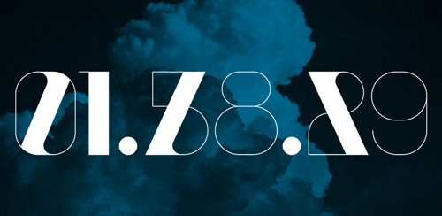
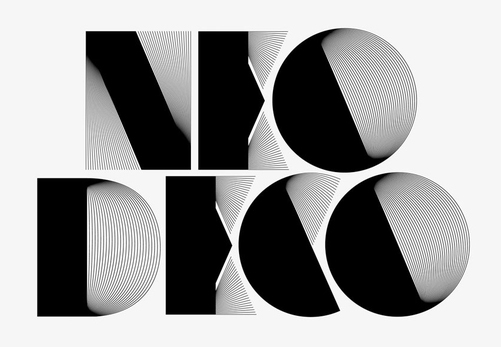
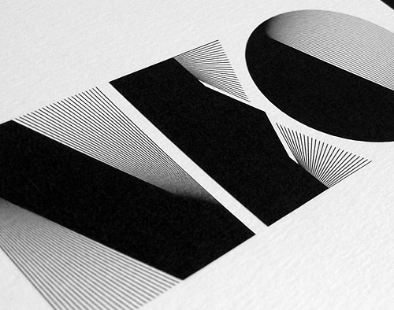
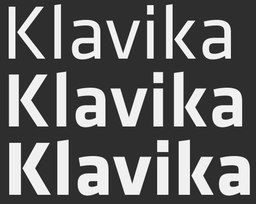
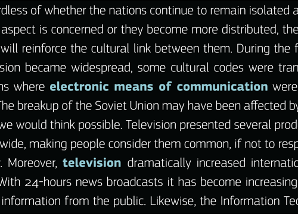
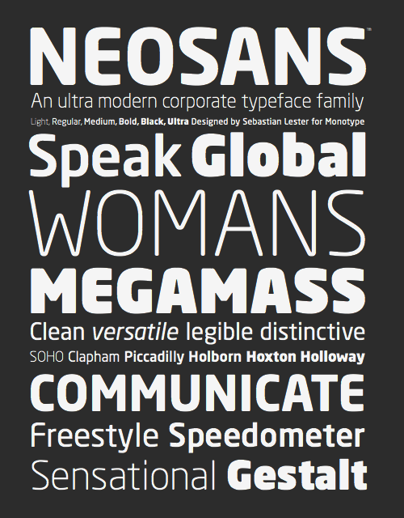
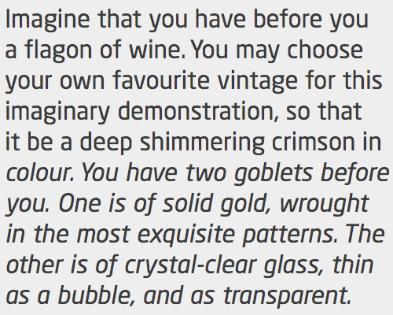

I have been doing some research of typefaces for the logo of my magazine. I feel this is important as all other typefaces will need to compliment it, as I don’t want too much disparity in the logo and large headings. Here are some headline and logo fonts I looked at in consideration for my logo typeface or titles:

**Fabrizio**

Looking at Fabrizio, it’s a very magazine looking font and would go well with something focusing a lot more on fashion, however Spark is mostly focused on technology and science, with only a part on fashion, so this font is perhaps not very well suited as it looks ‘high fashion’.

**New Modern**

Again, New Modern look high fashion, however this time the typeface looks very modern and could convey a sense of technology quite well, however it lacks something which makes it look like it speaks for many different areas. It still looks like it belongs with fashion more than anything else.

**Neo Deco**

Neo Deco is a very fascinating typeface. Something which would only ever be used for the logo, however I feel that the extremely fine detailing will be lost when set with imagery on a magazine cover. This font would work very well with the subject matter though since it’s bold and technical. I am looking for a font which wil carry through in the design of the entire magazine though, so perhaps this won’t be my choice.

**Klavika**

I started looking at more ‘corporate’ fonts, Klavika is probably most famous for being the font used for Facebook, however it has a very technical feel too it, and it’s various weights could be utilised in many areas of an editorial design. The only problem however is the price, it’s extremely expensive and therefore, I’m out.

**Square Sans Pro**

Square Sans Pro, much like Klavika have many versatile weights, however I was more interested in its use in the body of my editorial. I feel it would go well with many other headline typefaces so it’s a good candidate for my body copy font.

**Neo Sans**

Neo Sans is my top contender for the body copy, it is very modern, conveys technology well, and is even the font used for NewScientist magazine and Intel. This means that it would fit in very well with the subject matter of Spark magazine. However, again like with the other fonts is very expensive, and if I choose to use it, would only be able to use one weight.

I will continue looking at fonts and see how they might be best suited for my magazine redesign, looking at how they contribute to the look and feel of the magazine and relate to the editorial they will be translating the information through their aesthetic appeal.
