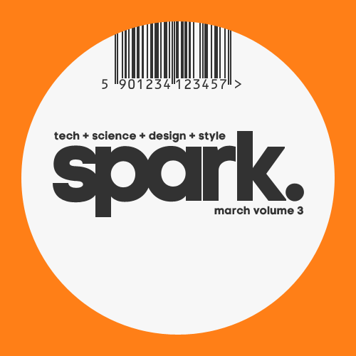

After acquiring the Code Pro font I began experimenting with the new typefaces, referring back to my initial ideas for the logo which I came up with. I wanted to stick with the lowercase characters and the full stop at the end as I felt this was provocative, almost like a prompt. My hope is that when people see this they will subconsciously think of things such as directness, provocativeness and something which comes across as intellectually stimulating.

I have also started looking at a colour palette that can be used. I am inclined towards a bright orange as it is highly visible and a bold colour which initiates some kind of urgency. I will continue to develop this further as I carry on the development, however I want to concentrate on thinking about layout next now that I have a basis for the design on the magazine which I want to correspond with the brand’s identity.

Thinking back to my research I noticed a lot of magazines now used circles to encompass the cover’s information, and even using the barcode much like Little White Lies right next to the logo. I did some experiments with the logo within a circle as well, however I would like to make a concept for the cover before going any further with that idea so I can get a better sense of the size proportions.

The orange area represents what would be the background, so this could be anything, such as the cover’s image. I might also explore the possibility of having the colour palette for the cover dynamic and change depending on the cover’s image. I feel now I can progress through into other areas now that I have a logo, something which can communicate how I want the magazine to be perceived now. This will help me in terms of the typography used within the editorial and how ultimately the magazine will be laid out.
