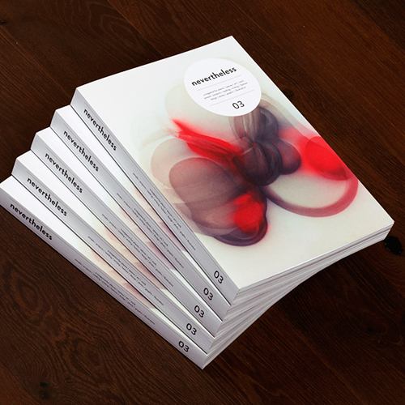
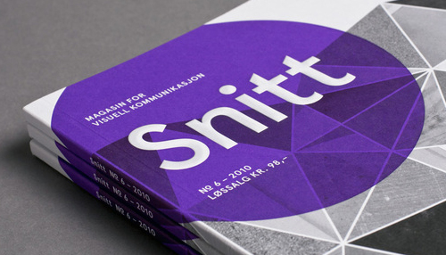
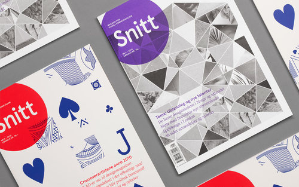
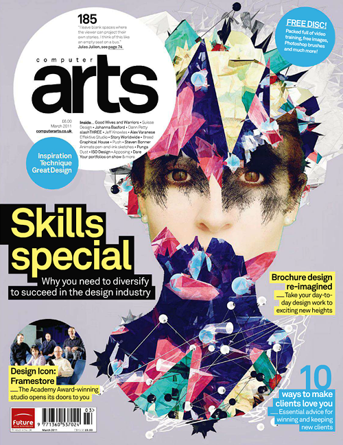
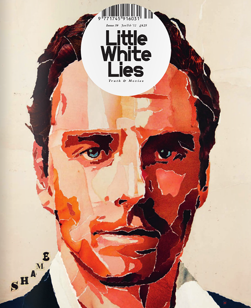
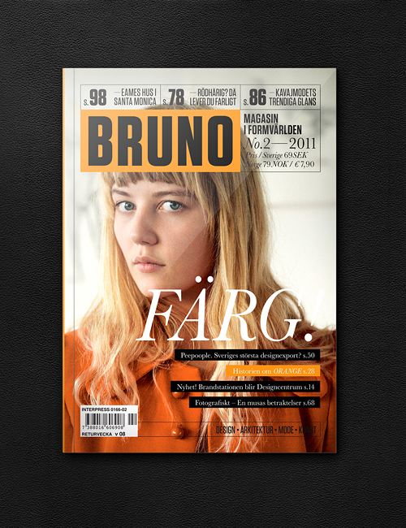

I have been looking at a few magazines to get some design inspiration of where I can take my magazine. In particular how I can design the magazine’s title or logo. In my searches I noticed an interesting trend with circles encompassing the title or logo for the magazine. I want to explore this and see how it could work with Spark. I will aslo need to do some research into what typeface I can use.

Here are a few notable examples of other magazines I looked at either in the store or on Behance, which has a good showcase of editorial design for me to pick design ideas from:

I really liked this use of the circle, it can hold a lot of information in a tight boundary, allowing the cover image to show without any distractions. I also liked how Little White Lies handled the barcode by making it a design focal point in the circle above the logo. The Snitt magazine cover also stook out to me, using a (possibly) multiply blend mode over the image beneath it gives it a dynamic look as the logo and image merge into each other, something which transparency would fail to do.

I also saw a magazine called BRUNO which had a large, bold title that had good use of colour and an interesting layout with the information in a grid, something I hadn’t seen before. I also thought the use of typefaces was something to take note of, the combination of hard blocky industrial headline fonts and thin, delicate serif fonts works rather well, complimenting each other. Something I thinking about for my typefaces.
