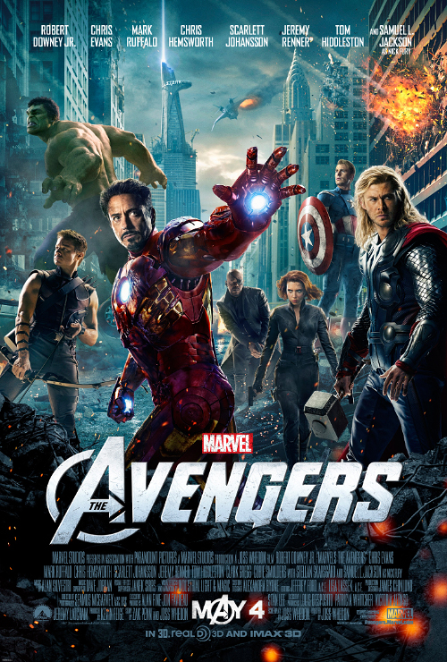

A new Avengers trailer comes out today, and with it, an awesome new poster displaying a good example of image manipulation in film posters. Doesn’t look like it would be too much of a stretch to create something like this as long as you have the right resource photos. I am also noticing how they have handled the background, it has cool colours and becomes muted, much like what I tried to do with my main piece.

Another thing I like, and it’s something I have seen elsewhere, is the subtle use of glowing particles, like there is burning debris somewhere in the scene, this really adds something dynamic to the overal scene. Another thing I might want to do at some point, would be to look at some techniques for making cinematic style text you often see on this kind of material. I personally don’t particularly like that style of typography anywhere else, but on big budget spectacle film posters I think it works well. I could try out some of the things I can see here in something of my own, perhaps in the next assignment and expand on my previous attempt and create another cinematic film poster composition for one of my pieces.
