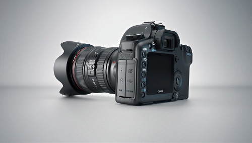
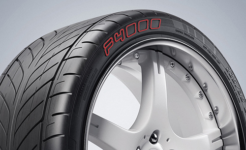
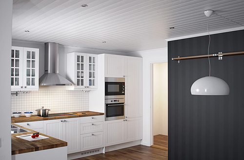
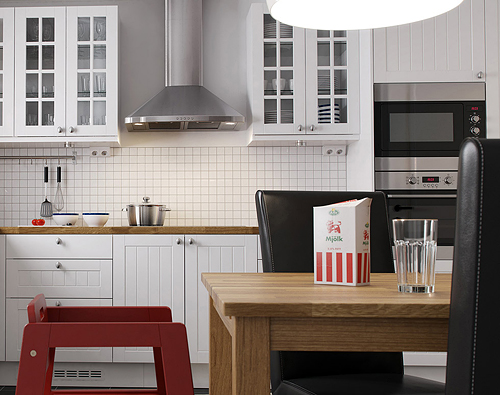
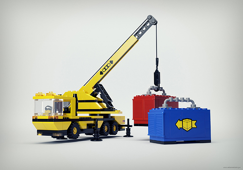

I was on [Dribbble](http://dribbble.com/) one day and came across some really realistic looking 3D work by a guy called [Mikael Eidenberg](http://www.mikaeleidenberg.se/). I really like this style, it looks as though it was rendered using something like VRay or another physically based renderer. Houdini has one of these built in so I may try to figure it out. Here are some examples of his work:

For my second assignment I will consider if I want to go down the route of trying to create something which takes on the qualities that architecture renders have. The only problem I see with this is that it doesn’t incorporate extensive use of other skills besides nor would it be part of another assignment. I will have to consider this inorder to come up with an idea for what I will ultimately do.
