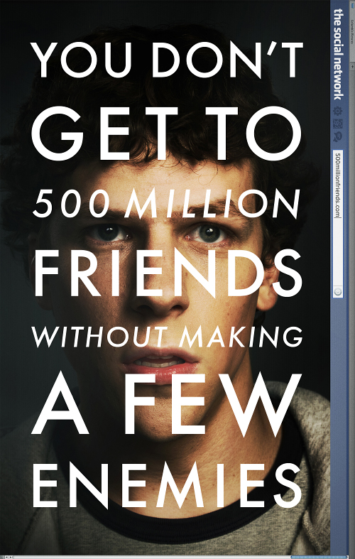

At the beginning of the task, myself personally didn’t see the full extent as to how difficult this brief would be, and I believe that was one of the biggest benefits to addressing the brief. I feel that if we had known how fundamentally challenging it would be from the start we might not have even bothered with it or quit soon after starting, however after coming up with ideas which we were told would be terrible, and that going through the basics of what the brief was asking, a heavy weight had been lifted and there were some breakthrough ideas being generated which were a lot more focused. Most notably the inspiration Tia had from a shampoo advert she saw, this then became the basis for the advertising campaign we started designing, along with the statistic of 1 in 155, which the concept revolved around.

The logo came from our initial ideas, such as an app, which would get everyone involved in the square mile who used the app, communicating with each other and would offer incentives for being associated with it, much like some sort of socially socially power offers network, that would also educate people about the square mile and its people. However this turned out to not really meet the breif’s expectations and was eventually dropped in favour for a poster campaign that leads to a website where people can find out more about the square mile, its inhabitants, who they are and what they do. The main issue with our previous ideas was, how do you get people to pay attention? We took the shampoo advert idea which asked the question: “Does s/he or doesn’t s/he?”, which was ambiguous and juxtaposed with carefully chosen portrait photography, causing the audience to question what the poster was implying.

After further development the posters were refined with the question: “Is s/he? Or isn’t s/he? 1 in 155 are.” meaning the questions were less ambiguous but still were vague enough to draw people in without suggesting they are posters for chlamydia or something wildly different like that. The 1 in 155 gave the posters some basis for which people might have guesses about, however would need to visit the accompanying URL to find out more. So this then gave us the audience for the campaign, it also meant that people weren’t unwillingly being shown posters for a cause they really don’t want to know about, since the banking sector and those associated with it are a sensitive issue, something that wouldn’t warrant an obvious and frank campaign. It was very clear to us that in order for it to work at all it was going to have to be obscure and target those who are open minded enough to want to find out more in the first place.

Regarding the posters, photography was going to be a major aspect. We searched extensively for the perfect stock, since we didn’t have access to professional photographers and models which would have been a logistics nightmare to get to the standard that was needed, we opted for some rather expensive stock photos depicting ’normal’ people in well lit studio environments which was modern and well composed. The photos were easy to manipulate meaning all mannor of shapes for the posters could be achieved, we displayed this through a series of different sized posters, such as long billboards and thin phone box posters and your average 6 sheet poster size in order to get across the flexibility of the poster design which seemed to be an important aspect of the brief. The photography was combined with minimal typography, inspired by various film posters such as The Social Network, among others:

The photography used was a combination of stock and some creative commons photographs. We decided that the international side of the campaign would need to take on a different approach fromt he local UK based campaign, and therefore took the logo and placed it over various London landmarks with the line “London’s Beating Heart” to show that it is the hub of the London and the UK’s economy which is designed to entice international investors into the city or to simply show how the city wants to perceive itself. This part of the brief however seemed to be an entire brief on its own so we didn’t go into too much depth about it, simply showed how the Square Mile brand could be used for outside markets.

There was also the website and the aspect of how other people would use the Square Mile brand. The ideas behind these were that people would be enticed into visiting the website through the ambiguous print campaign and directed to the 1 in 155 website which would divulge information on how the people of the square mile are essential to Britain’s economic progress and what is being done to rebuild the country. We also explained how the brand would be easily deployable for anyone within the square mile and that local partners can benefit through association with the brand. So the Square Mile brand then becomes an endorsement so that the public can see these partners are affiliated and part of the improvement of the city’s financial centre and through this people will become more knowledgable of the Square Mile and the people within it, giving them a human face almost.

I think our approach was one of the only ones that could be taken, when considering the subject matter. There was no way that the campaign could have been in the face of the audience since that would probably end up with everyone being insulted or repelled by the advertising. This type of campaign would almost certainly need to be vague and slow, something which would be deployed among the inhabitants first and then expanded outwards as to avoid any backlash from a public who still don’t trust or value bankers. However I feel what we have shown is something that will break through that barrier and at least provide some helpful information about the normal people who work there and keep a major part of the economy running which in theory would help people see that it’s not all about the slimy money grabbers at the top of the skyscrapers, changing their opinions gradually. At least that’s what we have set out to do with this answer to the brief.

**Photography Credit**

Images used under the Creative Commons licence agreement:

**[Aurelien Guichard](http://flickr.com/people/28536568@N00)**  
[30 St Mary Axe](http://flickr.com/photos/28536568@N00/3803200759)

**[David Iliff](http://en.wikipedia.org/wiki/User:Diliff)**  
[Cabot Square, Canary Wharf](http://en.wikipedia.org/wiki/File:Cabot_Square,_Canary_Wharf_-_June_2008.jpg)  
[Leadenhall Market In London](http://en.wikipedia.org/wiki/File:Leadenhall_Market_In_London_-_Feb_2006.jpg)  
[Tower bridge London Twilight](http://en.wikipedia.org/wiki/File:Tower_bridge_London_Twilight_-_November_2006.jpg)

Stock images:

[Phone Booth Advertising Space](http://en.fotolia.com/id/21893483)  
[London Underground Billboard](http://en.fotolia.com/id/21895688)

[Father](http://www.istockphoto.com/stock-photo-19089169-portrait-of-a-man.php?st=dfc58a1)  
[Daughter](http://www.istockphoto.com/stock-photo-17338704-portrait-of-a-smiling-woman.php?st=dfc58a1)  
[Next Door Neighbour](http://www.istockphoto.com/stock-photo-19430038-portrait-of-an-north-african.php?st=dfc58a1)  
[Woman in the Library](http://www.istockphoto.com/stock-photo-16948764-portrait-of-a-smiling-woman.php?st=dfc58a1)
