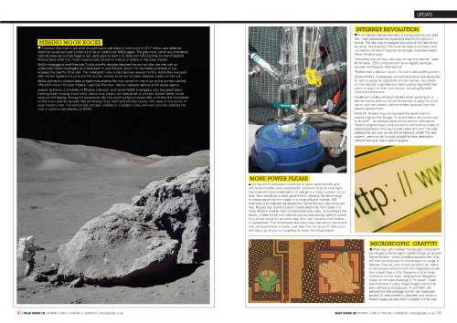
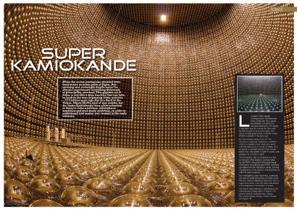
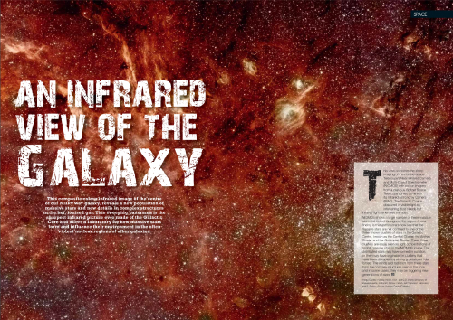
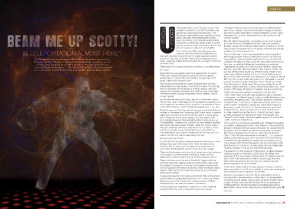
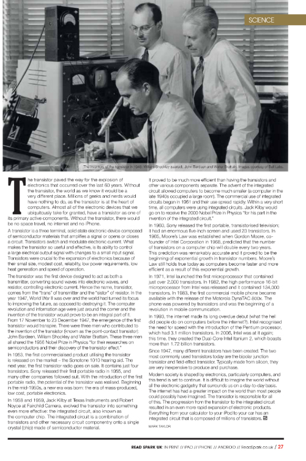

One of the first pages we get to when first viewing the magazine is an atrocious contents page. It for some reason uses a faux brushed metal texture, with the contents over the top in a simple list format. This is probably the only time I’ve ever come across a contents spread like this and appears to be optimised for digital purposes. This is something that will need to be resolved in my redesign, making sure that the print version utilises the space available to be read via magazine pages, and not click on.

It is interesting seeing a magazine use a more book-like contents, they usually are very visually stimulating and confusing to a certain extent, with many images and headlines and descriptions in a grid usually with many of the elements seeking attention and trying to be noticed over other elements. I may look into how this type of contents system can be better used as it is refreshing compared to many other magazines.

Upon navigating to where the editorial content begins we are presented with a few initial pages labelled the Update section, which do not seem so bad. They appear to contain a few snippets of information, not enough to warrant being full articles. This part of the magazine mostly comes across as coherently designed. There is some apparent grid that everything is positioned within and the design is consistent.

There are a few things I would point out as not being as good as they can be, including the very shallow leading used. Headings aren’t defined and the information blurs into on hard to follow block. The margins are non existent, so text is crammed into the grid with barely any whitespace and there are far too many unnecessary lines and blocks of colour.

One thing that has struck me is the use of having heading highlighted in yellow, this is not used anywhere else in the magazine. This may be a design feature defining a specific area of the magazine, but with the element not repeated anywhere else, not even different colours, it seems to be arbitrary placed with not much meaning behind it. I feel something like this could be handle better, however for the most part this is the most constantly design and laid out section of the magazine.

We then come across a few seemingly random pages that feature a full spread image with some transparent boxes containing text. I feel these pages could be handled much better, for instance there has been no attempt at editing the images to show the text better. It quickly becomes difficult to read as the first image of the Super Kamiokande has a texture which the overlaid text blends into, making it hard to discern the letter forms.

The information is then present over the top of the image in a box, with terrible margins creating awkward spacing and an added image too small to see this part is probably something I would remove entirely. I would find a way of having the image not be obscured as this seems to counter the point of having a full spread image, and I would give the text some more room so things don’t get crammed into one-another.

The use of colour for the category even blends in entirely as well, so that is something I will need to be aware of, the ways the photography and imagery interact with my existing colour scheme and what I can do to avoid them merging together and becoming hard to recognise.

The feature image pages also have a different font for every page, in fact, from this point forwards almost every headline is in a totally different font. The Typefaces need to be entirely rethought. I will make sure I keep my typeface usage consistent so a defined pattern emerges meaning people can tell the importance or priority of parts of the copy through the use of typography.

Next we come to a full article. The main thing that I instantly notice is the hugeness of the columns. They are far too wide and there is no noticeable margin giving the content any definition. The copy forms large blocks, almost two walls of text which aren’t broken up by anything. Pages like this could use some white space in order to break up the content so our eyes can better take in the information. Additionally, I am noticing the font sizes are far too big, especially for something which is printed as big as this magazine. It looks as though it was designed to be printed half the size it really is.

And again looking at how the content is laid out, it’s evident there isn’t any use of margins and the grid it is based on is too simple and static. There is next to no variation in how the article are presented. As I look through the rest of the magazine these trends seem to repeat, articles with many headline fonts, poor leading, no margins, static, uninspiring layout. This magazine will need a major redesign to put it into the league which it is being sold in.

Next to magazines like Wired and GQ, Spark looks very amateurish in its design and how it handles itself in terms of usability. The magazine feels confused between being a digital version and a print version and ends up being a cross between the two that works for neither formats. The large copy and linear layout is boring and uninspired and often difficult to read in print and is entirely useless for small screened devices like smartphones and tablets.

It is clear that my task will be to bring into line a designated print version of the magazine with design cues that would be expected of a magazine in such a high price band and next to higher brow magazines with a target market very much inclined towards good design, people would be critical of something poorly designed like this magazine. I will have to think about how I can incorporate this into my brief as this could the types of issues to address.
