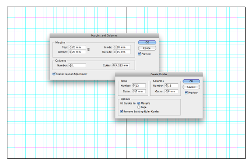
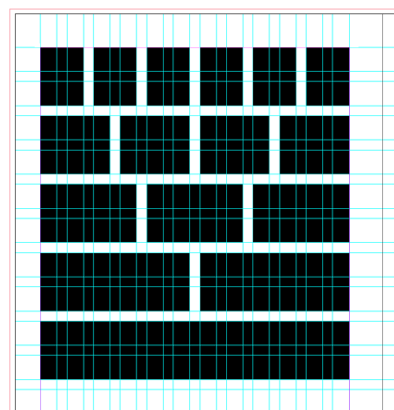

I took time in considering how to set up the grids and margins for my magazine so that there was a lot of flexibility later on. First of all I created the size of the magazine to be slightly shorter than A4 and slightly wider at 220mm wide by 280mm high, this I feel would give me some much needed width which I feel is more important than height. This was evident when I was laying out some magazine pages during the week tasks during class using A4 as the default.

The shape of the A4 felt claustrophobic and quickly elements became squashed together with not much whitespace available. Gutters had to be made small and the needed to be a reduced number of columns. I did not make this mistake again and decided to come up with my own dimensions for the magazine pages. This also puts my magazine in line with many other magazine as they are also slightly short and wider than A4.

One of the first things I did was add margins and a 3mm bleed. I tried to think of how the magazine would be viewed in reality and accounted for the inside margin being in the fold of the magazine so that was given a 20mm margin, as was the bottom since it needed to accommodate the page number and information, then again at the top as this was going to contain the category of the sections for the magazine’s content. Finally a slightly smaller margin for the outside edges of 15mm, this would be enough for people to hold but also offset the larger margin at the bottom and top, while also retaining a similar size when the magazine is folded on the inner edge.

I struggled for some time with how I was going to create a grid for my pages. I went through some trial and error, filling the pages with some place filler content such as images and body copy to see what felt comfortable. However after some tests I found that a 12 by 12 grid with a 6mm gutter was the best configuration. The number twelve is easily devisable which will give me a very flexible layout as it can accommodate 6, 4, 3, 2 and 1 column layout.

This is much more than what I could get out of setting up the columns manually, by having a grid, not only do I have vertical guides, but I also have the page divided horizontally as well which will help with images and small bodies of text. One of the downfalls of the current Spark magazine design is that the pages feel very dull as there is little variation in image placement. With this dynamic grid I can place elements in an array of places on the page while also keeping a consistent grid keeping things neat without making the reader feel uneasy with the placement of imagery and text.

I have also used a 12pt baseline as this will give me a lot of multiples of which to give different sized text appropriate leading. I have found this to be the best option for me as other numbers have very few multiples meaning the increments in the leading would be huge rendering the design of things like headlines and subheadings very difficult to properly align.
